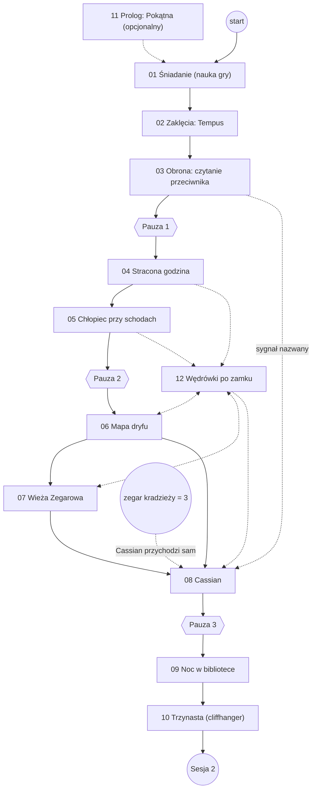

## Zarys

Hogwart, poniedziałek **22 września 1969** (trzeci tydzień roku szkolnego; propozycja wykonawcza, zob. pytanie 5). Postacie graczy, szóstoroczni tuż po SUM-ach, przeżywają zwykły dzień lekcji, a po południu tracą godzinę, której nie pamiętają. Wieczorem spotykają Ansela, chłopca, którego nikt inny nie widzi. Przez kolejne półtora dnia w fikcji mierzą, skąd ucieka czas, trafiają na Cassiana Vane'a, który ten czas podbiera, i nocą w bibliotece znajdują ukrytą pracownię profesor Marrow. Gdy wynoszą jej dziennik, wszystkie zegary w zamku wybijają trzynastą, a Ansel zaczyna blednąć. Sesja kończy się pytaniem: co robicie z dziennikiem i z chłopcem?

**Dla kogo.** 2–3 graczy, wszyscy grają pierwszy raz. Scenariusz uczy gry po kolei: scena 01 (albo prolog 11) to rozmowa i jeden prosty test, scena 02 to pierwsze zaklęcie, scena 03 to pierwszy test przeciwny, scena 08 to pierwszy pojedynek. Każda nowa zasada pojawia się dopiero wtedy, gdy jest potrzebna.

**Czas.** Rdzeń (sceny 01–10) to około 4 h 25 min. Limit 4–4,5 h nie jest sztywny: są trzy punkty pauzy, a sesja może się przerwać i wrócić od tego miejsca (decyzja MG z 2026-11-20).

## Co sesja musi zapewnić

1. **Być uczniami.** Dwie lekcje (Zaklęcia, Obrona przed Czarną Magią), z których każda daje narzędzie potrzebne jeszcze tego samego dnia.
2. **Nauczyć gry.** Pierwsza scena: rozmowa z bohaterem niezależnym i jeden prosty test. Zasady przychodzą po jednej.
3. **Kontakt każdej postaci z Anselem.** Stopniowo (mignięcie, rozmowa, towarzyszenie, blednięcie), ale nikt nie kończy sesji bez rozmowy z chłopcem. Licznik: `flaga.ansel-kontakt`.
4. **Plotka, nie wojna.** Imię Voldemorta i słowo „śmierciożercy” padają raz, szeptem, jako plotka (scena 01). Nikt jej nie potwierdza.
5. **Crake tylko w przelocie.** Jedna krótka pogawędka; dłuższa rozmowa wyłącznie przy bardzo wysokim wyniku testu spostrzegawczości.
6. **Swoboda.** Wędrówki po zamku (scena 12) i opcjonalna Pokątna (scena 11) wpinają się bez psucia ciągu.
7. **Porażka prowadzi naprzód.** Żaden nieudany test nie zamyka drogi; zmienia cenę (czas, hałas, szlaban, reputacja).
8. **Cliffhanger.** Koniec przy wyborze, co zrobić z dziennikiem i Anselem.

## Prawda dla MG

- **Profesor Imelda Marrow** [nasze], dawna nauczycielka Astronomii, w 1951 roku użyła Klepsydry Daniny, by cofnąć śmierć jedenastoletniego Ansela Draya. Koszt rozłożyła na wszystkich w zamku. Przerażona, związała Klepsydrę w mechanizmie Wieży Zegarowej, zostawiła ukrytą pracownię (Salę Zatrzymanych Godzin, za ostatnim rzędem Działu Ksiąg Zakazanych) i dziennik, po czym odeszła.
- **Ansel** trwa dzięki skradzionym godzinom. Widzą go tylko ci, którzy stracili czas. Nie ma go w żadnym spisie. Pamięta tylko polecenie „czekaj przy schodach”.
- **Wycieki.** Klepsydra w wieży przecieka, bo **Hollis Crake** [nasze], zegarmistrz konserwujący zamkowe zegary, od tygodni rozluźnia jej pieczęć. Sama wieża niczego nie pokazuje (jest tylko kotwicą). W Sesji 1 Crake jest tłem: życzliwy pan na drabinie.
- **Cassian Vane** [nasze], szósty rok, Slytherin, około trzech tygodni temu trafił do pracowni, uciekł przed pułapkami z jedną wyrwaną kartą (Kartą Pożyczającego). Karta uczy podbierać czas z istniejących wycieków przez zatrzymany zegarek kieszonkowy. Każde podebranie to czyjaś stracona godzina. Stracona godzina postaci graczy to jego robota (ćwiczył przed sprawdzianem).
- **Dziennik Marrow** jest związany magią z gablotą, która otwiera się, gdy godzinę ktoś **odda**, a nie zabierze. Gdy dziennik opuszcza pracownię, zegary wybijają trzynastą, a Ansel traci jedną z kotwic.
- **Dumbledore** czuje, że coś jest nie tak, ale odkłada sprawę. Magia czasu go nie dotyka, więc nie widzi Ansela.
- **Patron** (śmierciożerca, który dla Voldemorta szuka informacji o Klepsydrze) jest w Sesji 1 tylko śladem w tle. Tożsamość czeka na decyzję MG (sekcja „Kandydaci na Patrona”).

**Zmiana względem archiwum:** „Foliał” nazywamy **dziennikiem Marrow** (jak w zarysie); rok 1969 zamiast 1976; mechanika z archiwum (Drabina Wyników, progi k20, Dziennik Lekcji, punkty domów) wypada, testy ustali mechanik według Walkera.

## Stałe i elastyczne

**Stałe (nie zmieniają się bez względu na decyzje graczy):**
- Ansel istnieje i każda postać gracza ma z nim kontakt w tej sesji.
- Cassian ma kartę i zegarek; to on kradnie godziny.
- Pracownia jest za ostatnim rzędem Działu Ksiąg Zakazanych, a dziennik w gablocie.
- Wieża Zegarowa jest czysta (ślepy zaułek z ziarnem: plakietka i olej).
- Zegary wybijają trzynastą, gdy dziennik opuszcza pracownię (albo wariant awaryjny w scenie 10).

**Elastyczne:**
- Kolejność scen 06, 07, 08 i 12; która postać co znajdzie i jak.
- Czy rozegrany będzie prolog na Pokątnej (11).
- Czy i jak dojdzie do pojedynku z Cassianem (pojedynek, targ, kradzież zegarka, donos).
- Jak otworzą gablotę i czy w ogóle.
- Czy złapie ich Filch.
- Kto z nauczycieli i duchów wejdzie do gry (scena 12).

## Przebieg w skrócie

### Tabela scen

| Id | Tytuł roboczy | Czas | Kiedy w fikcji | Rodzaj |
|---|---|---|---|---|
| s1.scena.11 | Prolog: ulica Pokątna (opcjonalny) | 30 min | sobota 30 sierpnia 1969 | elastyczna |
| s1.scena.01 | Śniadanie w Wielkiej Sali | 20 min | pon. 22.09, rano | rdzeń, nauka gry |
| s1.scena.02 | Zaklęcia: Tempus | 30 min | pon., przed południem | rdzeń, lekcja |
| s1.scena.03 | Obrona: czytanie przeciwnika | 30 min | pon., po południu | rdzeń, lekcja |
| s1.scena.04 | Stracona godzina | 15 min | pon., po lekcjach | rdzeń |
| s1.scena.05 | Chłopiec przy schodach | 25 min | pon., wieczór | rdzeń |
| s1.scena.06 | Mapa dryfu | 30 min | wt., okienka i przerwy | rdzeń, węzeł śledztwa |
| s1.scena.07 | Wieża Zegarowa | 20 min | wt., po południu | rdzeń, ślepy zaułek z ziarnem |
| s1.scena.08 | Cassian | 35 min | wt., wieczór | rdzeń, pierwszy pojedynek |
| s1.scena.09 | Noc w bibliotece: trzynaste drzwi i Sala Zatrzymanych Godzin | 45 min | noc wt./śr. | rdzeń, kulminacja |
| s1.scena.10 | Trzynasta (cliffhanger) | 15 min | ta sama noc | rdzeń, finał |
| s1.scena.12 | Wędrówki po zamku (moduł spotkań) | 5–30 min | dowolnie po scenie 04 | elastyczna |

**Rdzeń 01–10: 265 min (4 h 25 min).** Z prologiem 11: około 4 h 55 min. Przy dwóch graczach sceny lekcyjne i scena 06 skracają się mniej więcej o jedną piątą. Do tego 10–15 minut przed grą na linie i zasłony (tematy wykluczone i poza kadrem) oraz objaśnienie kości.

### Sceny: opis, wejście, wyjście, flagi

**s1.scena.11 Prolog: ulica Pokątna (opcjonalny, 30 min).** Ostatnie zakupy przed szkołą. Postać, która potrzebuje nowej różdżki (złamana w wakacje, odziedziczona, „nie słucha”), idzie do Ollivandera; reszta kupuje podręczniki do szóstego roku. Przy witrynie „Crake i Córka” starszy pan poprawia wskazówki: tu wypada przelotna pogawędka z Crake'iem. Gazeciarz krzyczy tytuły; ktoś w kolejce szepcze plotkę. Jeśli prolog jest grany, **przejmuje rolę sceny nauczającej** (rozmowa + jeden prosty test), a scena 01 skraca się do 10 minut.
- Wejście: decyzja MG przed sesją (zob. pytanie 2). Brak wymaganych flag.
- Wyjście: przeskok czasowy „trzy tygodnie później” do sceny 01.
- Ustawia: `flaga.s1-prolog-pokatna`, `flaga.crake-poznany`, ewentualnie `flaga.crake-dluga-rozmowa`, `flaga.plotka-o-voldemorcie`.
- Następne: s1.scena.01.

**s1.scena.01 Śniadanie w Wielkiej Sali (20 min).** Scena nauczająca. Sowy, plan lekcji, rozmowa z gadatliwym kolegą z roku (pierwszy dialog: gracz mówi w imieniu postaci, MG odpowiada). Od stołu Slytherinu dolatuje szept o „Czarnym Panu” i „śmierciożercach”; kolega wzrusza ramionami, że to bajki. Jeden prosty test: zauważyć coś przy stole (Wits + Observation, niski próg; liczby ustali mechanik), np. Cassiana, który zerka na zegarek bez ruchomej wskazówki. Filch, nowy woźny, przegania kogoś z sali. Jeśli prologu nie było, przez Salę Wejściową przechodzi Crake z drabiną (pogawędka ruchoma, zob. niżej).
- Wejście: początek sesji albo po prologu.
- Wyjście: dzwonek na Zaklęcia.
- Ustawia: `flaga.plotka-o-voldemorcie`; opcjonalnie `flaga.crake-poznany`.
- Następne: s1.scena.02.

**s1.scena.02 Zaklęcia: Tempus (30 min).** Flitwick uczy zaklęcia Tempus (pokazuje prawdziwą chwilę, nie wskazania zegara). Pierwszy test magiczny każdej postaci. Mimochodem: „Wieża boczy się od dwóch tygodni, pan Filch twierdzi, że dzwony chodzą wolno”. Zadaje pracę domową: zmierzyć przesunięcie trzech zegarów na różnych piętrach. Ciekawskim podsuwa tytuł książki z Działu Ksiąg Zakazanych i może podpisać przepustkę. **Zależne od decyzji MG:** Tempus na lekcji 6. roku (trudność 9 według zasady domowej ZD-21; rok nauki jeszcze nieustalony). Wariant zapasowy, gdyby MG nie chciał Tempus: Flitwick pokazuje Tempus jako zaklęcie „na później”, a uczniowie pracują na mosiężnych zegarkach podróżnych; wszystkie wskazówki mają drogi bez Tempus (tabela trzech dróg).
- Wejście: brak warunków.
- Wyjście: koniec lekcji. Opuszczenie lekcji nie blokuje: praca domowa i tak dociera (kolega, Flitwick na korytarzu).
- Ustawia: `flaga.tempus-opanowane`, `flaga.praca-domowa-dryf`, opcjonalnie `flaga.przepustka-flitwicka`.
- Następne: s1.scena.03.

**s1.scena.03 Obrona przed Czarną Magią: czytanie przeciwnika (30 min).** Profesor Wren [nasze]: „Przeciwnik zawsze mówi, co zrobi”. Ćwiczenie na dwóch uczniach tła, którzy mają widoczne nawyki (pierwsza nauka testu przeciwnego). Potem pokaz: Cassian walczy z jedną z postaci i działa dwa razy, zanim ona skończy, po czym dotyka kieszonki kamizelki. Kto nazwie ten sygnał na głos, ma przewagę w scenie 08. Po lekcji Wren może rzucić uwagę o ocenach Vane'a.
- Wejście: brak warunków.
- Wyjście: koniec lekcji, korytarz.
- Ustawia: `flaga.sygnal-cassiana-nazwany`, opcjonalnie `flaga.wren-podejrzewa`.
- Następne: s1.scena.04. **Punkt pauzy 1** po tej scenie.

**s1.scena.04 Stracona godzina (15 min).** Złote światło na korytarzu, mrugnięcie, dzwon bije godzinę później. Dla postaci nie minęła chwila; inni widzieli je stojące jak posągi. Każda postać dostaje osobisty ślad (zadrę): list sprzed miesiąca, skończony esej, spotkanie, na którym „była”, atrament na dłoniach. Na końcu jedna postać (ta, która się obejrzy) widzi na schodach chłopca w szacie Hufflepuffu, który znika: **mignięcie, pierwszy kontakt**.
- Wejście: po scenie 03 (albo w dowolnym momencie popołudnia, jeśli gracze zboczyli).
- Wyjście: rozejście się do pokojów wspólnych albo zgłoszenie sprawy nauczycielowi (Flitwick chce liczb, Wren pyta, czy Vane był w pobliżu, Dumbledore prosi, by obserwowali).
- Ustawia: `flaga.godzina-stracona`. Startuje `flaga.s1-zegar-kradziezy` (0).
- Następne: s1.scena.05; s1.scena.12 dostępna.

**s1.scena.05 Chłopiec przy schodach (25 min).** Wieczorem, u stóp cichych schodów przy kuchni, Ansel pyta, która godzina, bo „pani profesor Marrow kazała czekać przy schodach”. Widzą go wszystkie postacie, które straciły godzinę. Życzliwość (jedzenie, słuchanie, imię, którego może się trzymać) buduje więź; nieuprzejmość płoszy go na resztę wieczoru. Tempus na Anselu nie formuje cyfr; ręka przechodzi przez beczkę przy wejściu do Hufflepuffu.
- Wejście: `flaga.godzina-stracona`.
- Wyjście: Ansel znika, gdy ktoś inny nadchodzi, albo zostaje „przy schodach”.
- Ustawia: `flaga.ansel-spotkany`, `flaga.ansel-kontakt` (+1 za każdą postać obecną w rozmowie), opcjonalnie `flaga.ansel-poza-spisem`, `flaga.marrow-imie-znane`.
- Następne: s1.scena.06 albo s1.scena.12. **Punkt pauzy 2** po tej scenie.

**s1.scena.06 Mapa dryfu (30 min, węzeł śledztwa).** Praca domowa na serio. Gracze wybierają miejsca w zamku (minimum trzy, maksimum sześć przy początkujących) i porównują chwilę prawdziwą z zegarami. Dwa wzory: gładkie spóźnienia rosnące ku Wieży Zegarowej (przypływ) i drżące odczyty prowadzące do lochów (ktoś podbiera). Boczna droga: rozpytać uczniów, którzy też stracili godziny, i dopasować je do nagłych sukcesów Cassiana. Każde miejsce może być małą scenką z modułu 12.
- Wejście: `flaga.godzina-stracona` (praca domowa daje pretekst, ale nie jest konieczna).
- Wyjście: gracze idą za przypływem (07) albo za śladem (08). Obie kolejności działają.
- Ustawia: `flaga.przyplyw-ku-wiezy`, `flaga.slad-ukaszen`, `flaga.rejestr-godzin`.
- Następne: s1.scena.07, s1.scena.08, s1.scena.12.

**s1.scena.07 Wieża Zegarowa (20 min).** Wszystko wskazuje tutaj, a wieża jest doskonała: zero przesunięcia, mechanizm bez skazy. Celowy ślepy zaułek: gracze udowadniają, że odpowiedź leży gdzie indziej. Ziarno: świeży olej i mosiężna plakietka „Konserwacja: Crake i Córka, ulica Pokątna”. Za dnia Crake może właśnie schodzić z wieży (pogawędka ruchoma). O zmierzchu przychodzi tu Cassian podbierać czas: naturalne przejście do 08.
- Wejście: brak twardych warunków (gracze mogą przyjść z ciekawości).
- Wyjście: do 08 (Cassian przychodzi albo trop prowadzi do niego) lub z powrotem do 06/12.
- Ustawia: `flaga.wieza-zbadana`, `flaga.plakietka-crake`, opcjonalnie `flaga.crake-poznany`.
- Następne: s1.scena.08, s1.scena.06, s1.scena.12.

**s1.scena.08 Cassian (35 min).** Cztery drogi do konfrontacji: sygnał z kieszonki, dopasowane godziny, ślad drżących zegarów do przejścia Slytherinu, albo Cassian sam ich znajduje. Jest chłodny, potem roztrzęsiony; proponuje formalny pojedynek: jeśli przegra, powie, skąd ma kartę. Alternatywy: targ, kradzież zegarka, litość, donos do Wrena (brak dowodów, ale Wren zaczyna patrzeć). Każdy wynik prowadzi do 09 (zob. drogi awaryjne do pracowni).
- Wejście: co najmniej jedna z flag `flaga.sygnal-cassiana-nazwany`, `flaga.slad-ukaszen`, `flaga.rejestr-godzin`, `flaga.wieza-zbadana` **albo** `flaga.s1-zegar-kradziezy` = 3 (wtedy Cassian przychodzi sam).
- Wyjście: lokalizacja pracowni z ust Cassiana albo jedna z dróg awaryjnych.
- Ustawia: `flaga.cassian-zdemaskowany`, `flaga.cassian-los`, `flaga.zegarek-cassiana`, `flaga.karta-u-graczy`, `flaga.lokalizacja-pracowni`.
- Następne: s1.scena.09. **Punkt pauzy 3** po tej scenie.

**s1.scena.09 Noc w bibliotece (45 min).** Wejście do Działu Ksiąg Zakazanych (przepustka Flitwicka, szczera prośba do pani Pince albo zakradnięcie się nocą). Ostatni rząd, przycisk do książek w kształcie klepsydry, drzwi otwierane „godziną, której nie ma” (trzynaście). Na dole Sala Zatrzymanych Godzin: galeria wahadeł (pułapka do obejścia na kilka sposobów), ściana z zakazaną lekcją pożyczania chwili (pokusa) i gablota z dziennikiem, która otwiera się, gdy ktoś godzinę odda. Nocą ryzyko Filcha (kandydat: Zegar Północy; decyzja mechaniczna czeka).
- Wejście: `flaga.lokalizacja-pracowni` albo dotarcie drogą awaryjną (Tempus przy półkach, rejestr wypożyczeń, śledzenie Cassiana).
- Wyjście: z dziennikiem albo bez (każdy wariant prowadzi do 10).
- Ustawia: `flaga.pracownia-otwarta`, `flaga.pozyczona-chwila-poznana`, `flaga.gablota-sposob`, `flaga.dziennik-u-graczy`, `flaga.filch-zlapal`.
- Następne: s1.scena.10.

**s1.scena.10 Trzynasta (15 min, cliffhanger).** Gdy dziennik przekracza próg pracowni, każdy zegar w zamku wybija trzynastą, raz. Portrety budzą się, Irytek wyje. Ansel, który był z nimi albo czekał przy schodach, zaczyna blednąć: „Zrobiło się ciszej. Nie podoba mi się to”. Krótki epilog dla MG: w Londynie zegarmistrz podnosi głowę znad warsztatu. MG zadaje pytanie: **„Co robicie z dziennikiem i z Anselem?”** i kończy sesję (albo pozwala na pierwszą wymianę zdań, jeśli czas pozwala).
- Wejście: wyjście z 09 (z dziennikiem albo bez, zob. wariant awaryjny).
- Ustawia: `flaga.trzynasta-wybila`, `flaga.s1-wybor` (zwykle `nierozstrzygniety` na koniec sesji, wartość ustalona na początku Sesji 2 albo między sesjami).
- Następne: Sesja 2 (`brak` w tym scenariuszu).

**s1.scena.12 Wędrówki po zamku (moduł spotkań, 5–30 min).** Nie jedna scena, tylko zestaw krótkich spotkań do wpięcia, gdy gracze chcą chodzić po zamku: kuchnia i skrzaty, Gruby Mnich (duch Hufflepuffu), portret przy schodach, nauczyciel astronomii [nasze] z luną i wspomnieniem „pani Marrow”, pokój wspólny, sowiarnia, Filch na obchodzie, pierwszoroczniak, który zemdlał na schodach (ofiara Cassiana), pani Pince skarżąca się na „chłopca od Slughorna” wypożyczającego książki o zegarmistrzostwie. Każde spotkanie daje jedną drogę do wskazówki z tabeli trzech dróg albo moment z Anselem.
- Wejście: po `flaga.godzina-stracona`; przed nią tylko jako kolor.
- Wyjście: powrót do sceny, z której gracze wyszli, albo do następnej w grafie.
- Ustawia: dowolne flagi śledztwa zgodnie z tabelą trzech dróg; `flaga.ansel-kontakt` (spotkanie wyrównujące).

### Graf przejść



### Sceny elastyczne: jak je wpiąć bez psucia ciągu

- **Prolog na Pokątnej (11)** ma jedno miejsce: przed sceną 01, jako wspomnienie „trzy tygodnie wcześniej”. Nie wraca w środku tygodnia szkolnego, bo uczniowie nie mogą wyjść z zamku bez powodu. Daje to samo co scena 01 (nauka gry, plotka, Crake), więc gdy jest grany, scena 01 kurczy się do sowiej poczty i jednego zdania plotki. Gdy nie jest grany, nic nie ginie: Crake pojawia się w zamku, a różdżka może być „nowa od Ollivandera” w opisie postaci. Jeśli gracz bardzo chce wyprawy po różdżkę w środku sesji, wariant awaryjny: różdżka pęka w scenie 02 albo 08, McGonagall załatwia wyjście przez kominek w sobotę, czyli **po** Sesji 1 (otwarcie Sesji 2, gdzie i tak jedziemy na Pokątną).
- **Wędrówki po zamku (12)** to spotkania wielkości 5 minut. Zasada: jedno spotkanie = jedna wskazówka albo jeden moment z Anselem albo czysty kolor (jeśli gracze chcą po prostu pobyć w Hogwarcie). Zegar kradzieży rośnie o 1 za każde pół dnia w fikcji, więc długie wędrówki nie zatrzymują świata: Cassian sam w końcu przyjdzie (scena 08).
- **Pogawędka ruchoma z Crake'iem.** Crake pojawia się raz, w pierwszym pasującym miejscu: prolog 11 (witryna sklepu), scena 01 (Sala Wejściowa, drabina przy wielkim zegarze) albo scena 07 (schodzi z wieży). Test spostrzegawczości (Wits + Observation; próg ustali mechanik). Zwykły sukces: miły starszy pan, pachnie olejem, mówi, że „wieża ostatnio wymaga więcej uwagi”. **Tylko bardzo wysoki wynik** (propozycja: poziom Walkera „Impressive success”, czyli co najmniej dwa razy trudność, Walker 2e s. 3; do potwierdzenia przez mechanika): postać zauważa zdjęcie dziewczyny w kopercie jego zegarka; Crake się zatrzymuje i mówi chwilę dłużej o córce, która „pomagała mu w sklepie”. Crake kłamie gładko i niczego nie zdradza o Klepsydrze.

### Kontakt każdej postaci z Anselem (stopniowo)

| Stopień | Gdzie | Kto | Co się dzieje |
|---|---|---|---|
| 1. Mignięcie | 04 | jedna postać | chłopiec na schodach, znika |
| 2. Rozmowa | 05 | każda postać, która straciła godzinę | pierwsza rozmowa; `flaga.ansel-kontakt` +1 za każdą |
| 3. Towarzyszenie | 06, 07, 12 | postać z najwyższą Więzią albo ta, której Tempus „tyka” po porażce kompromitującej | Ansel idzie z nią, pomaga przy jednej wskazówce |
| 4. Blednięcie | 10 | wszyscy | Ansel słabnie; ważą się wybory |

**Siatka bezpieczeństwa.** Jeśli przed sceną 09 `flaga.ansel-kontakt` jest mniejsza niż liczba graczy (gracz spóźniony, drużyna rozdzielona, postać obraziła Ansela), MG wpina **spotkanie wyrównujące** z modułu 12: Ansel czeka na tę postać sam, np. siedzi na jej łóżku o świcie, stoi przy jej ławce w sali albo idzie za tykaniem jej zaklęcia. 5 minut, jedna rozmowa. Więź (kandydat: tracker 0–3 na postać) rośnie za życzliwość, nie za rzut.

### Punkty pauzy

| Pauza | Po scenie | Zegar przy stole (rdzeń) | Zdanie na zatrzymanie | Przy wznowieniu |
|---|---|---|---|---|
| 1 | 03 | ok. 1 h 35 min (z wprowadzeniem) | „Wychodzicie z sali. Światło na korytarzu ma dziwny, złoty odcień…” (zawieszenie tuż przed straconą godziną) | Przypomnij nauczycieli i sygnał Cassiana; startuj od sceny 04 |
| 2 | 05 | ok. 2 h 20 min | Ansel: „Przyjdziecie jutro? Ja tu będę. Zawsze tu jestem.” | Wtorek rano. Spisz `flaga.ansel-kontakt` i Więź; gracze mówią, co planują |
| 3 | 08 | ok. 3 h 35 min | Cassian (albo trop): „Biblioteka. Ostatni rząd.” Noc już zapada. | Start w nocy pod drzwiami biblioteki; zanotuj los Cassiana i przepustkę |

Jeśli sesja ma się skończyć na pauzie, zdanie z tabeli działa jako mały cliffhanger. Przed przerwą kronikarz albo MG zapisuje flagi w `04_kampania/stan-kampanii.md`.

**Skróty, gdy czas goni (bez straty wskazówek):** scena 01 do 10 minut; w scenie 06 trzy pomiary zamiast sześciu (druga wskazówka przez Ansela albo Wrena); scena 07 jednym akapitem i jednym testem; galeria wahadeł jednym testem grupowym.

### Zegar świata: kradzieże Cassiana (`flaga.s1-zegar-kradziezy`, 0–4)

Świat działa sam. Od straconej godziny (scena 04) Cassian podbiera dalej. +1 za każde pół dnia w fikcji, w którym postacie go nie skonfrontowały.

| Wartość | Co się dzieje w zamku |
|---|---|
| 1 | Drugoroczniak przesypia lekcję i „nie wie, kiedy zasnął” (plotka przy stole) |
| 2 | Pierwszoroczniak mdleje na schodach (spotkanie w module 12); Wren publicznie pyta, kto ostatnio „gubi czas” |
| 3 | Cassian, zdenerwowany wścibstwem, sam znajduje postacie (droga D do sceny 08) |
| 4 | Cassian idzie nocą do pracowni pierwszy i próbuje zabrać godzinę gablocie; postacie znajdują go tam albo trafiają na jego ślad (scena 09 z Cassianem w środku) |

Zegar zatrzymuje się, gdy `flaga.cassian-zdemaskowany` albo gdy zegarek trafia do graczy lub zostaje zniszczony.

### Tabela flag Sesji 1

| Flaga | Typ | Ustawiana w | Używana w |
|---|---|---|---|
| `flaga.s1-prolog-pokatna` | bool | 11 | 01 (skrócenie) |
| `flaga.plotka-o-voldemorcie` | bool | 11, 01 | Sesja 2 (więcej wzmianek) |
| `flaga.crake-poznany` | bool | 11, 01, 07 | 07, Sesja 2 |
| `flaga.crake-dluga-rozmowa` | bool | 11, 01, 07 | Sesja 2 |
| `flaga.tempus-opanowane` | bool | 02 | 04, 05, 06, 09 |
| `flaga.praca-domowa-dryf` | bool | 02 | 06 |
| `flaga.przepustka-flitwicka` | bool | 02 | 09 |
| `flaga.sygnal-cassiana-nazwany` | bool | 03 | 08 |
| `flaga.wren-podejrzewa` | bool | 03, 04 | 08 |
| `flaga.godzina-stracona` | bool | 04 | 05, 06, 12 |
| `flaga.ansel-spotkany` | bool | 05, 12 | 06, 09, 10 |
| `flaga.ansel-kontakt` | liczba | 05, 12 | kontrola przed 09 i 10 |
| `flaga.ansel-poza-spisem` | bool | 05, 12 | 10, Sesja 2 |
| `flaga.marrow-imie-znane` | bool | 05, 12 | 09, 10 |
| `flaga.przyplyw-ku-wiezy` | bool | 06, 12 | 07 |
| `flaga.slad-ukaszen` | bool | 06, 12 | 08 |
| `flaga.rejestr-godzin` | bool | 06, 12 | 08 |
| `flaga.wieza-zbadana` | bool | 07 | 08 |
| `flaga.plakietka-crake` | bool | 07 | Sesja 2 |
| `flaga.s1-zegar-kradziezy` | liczba | 04, potem co pół dnia | 08, 09 |
| `flaga.cassian-zdemaskowany` | bool | 08 | 09, Sesja 2 |
| `flaga.cassian-los` | wybór | 08 | Sesja 2 |
| `flaga.zegarek-cassiana` | wybór | 08 | 09 |
| `flaga.karta-u-graczy` | bool | 08 | 09 |
| `flaga.lokalizacja-pracowni` | bool | 08, 12 | 09 |
| `flaga.pracownia-otwarta` | bool | 09 | 10 |
| `flaga.pozyczona-chwila-poznana` | bool | 09 | Sesja 2 |
| `flaga.gablota-sposob` | wybór | 09 | 10, Sesja 2 |
| `flaga.dziennik-u-graczy` | bool | 09 | 10 |
| `flaga.filch-zlapal` | bool | 09 | 10, Sesja 2 |
| `flaga.trzynasta-wybila` | bool | 10 | Sesja 2 |
| `flaga.s1-wybor` | wybór | 10 | Sesja 2 |

### Zasada trzech dróg: kluczowe wskazówki

| Wskazówka | Drogi (każda działa sama) | Gdy gracze przegapią wszystkie |
|---|---|---|
| **W1. Godzina naprawdę zniknęła** (04) | 1) Tempus kontra własny zegarek: równo godzina różnicy; 2) świadkowie: „staliście jak posągi”, zegar w Wielkiej Sali; 3) osobisty ślad (zadra) każdej postaci; 4) Ansel pyta, która godzina | Flitwick: „Już trzecie zgłoszenie zgubionej godziny w tym tygodniu” |
| **W2. Ansel nie należy do teraźniejszości** (05, 12) | 1) Tempus nie formuje cyfr przy Anselu; 2) profesor Sprout nie ma go w rejestrze Hufflepuffu; 3) ręka przechodzi przez beczkę, inni uczniowie go mijają; 4) Gruby Mnich: „Znałem chłopca o tym imieniu… nie, to niemożliwe” | Ansel sam: „Pani profesor Marrow… a gdzie jest pani profesor?”, nauczyciel astronomii: „Marrow odeszła wiele lat temu” |
| **W3. Czas płynie ku Wieży Zegarowej** (06) | 1) mapa dryfu z Tempus; 2) porównanie zwykłych zegarków uczniów na różnych piętrach (bez magii); 3) Flitwick i Filch o „boczącej się” wieży i wolnych dzwonach; 4) Ansel czuje ciągnięcie i boi się dzwonu; 5) Crake: „wieża ostatnio wymaga uwagi” | Flitwick po lekcji, przeglądając pracę domową: „Wszystkie wasze błędy pochylają się w jedną stronę” |
| **W4. Ktoś podbiera czas, to Cassian** (03, 06, 08) | 1) sygnał z kieszonki na lekcji Wrena; 2) dopasowanie straconych godzin innych uczniów do sukcesów Cassiana; 3) ślad drżących odczytów do przejścia Slytherinu; 4) Cassian przy wieży o zmierzchu (07); 5) Wren o ocenach Vane'a | Zegar kradzieży = 3: Cassian sam przychodzi do postaci |
| **W5. Pracownia jest w ostatnim rzędzie Działu Ksiąg Zakazanych** (08, 09) | 1) Cassian mówi po przegranej, targu albo z litości; 2) rejestr wypożyczeń pani Pince: „Vane trzy razy prosił o ten sam tom o zegarmistrzostwie”; 3) śledzenie Cassiana albo drżących odczytów nocą do biblioteki; 4) rysunek półki na Karcie Pożyczającego; 5) Ansel z Więzią 2: „Pani profesor nosiła książki do najdalszego regału” | Zegar kradzieży = 4: Cassian idzie tam sam; kartka wypada mu z szaty w ucieczce |
| **W6. Drzwi otwiera „godzina, której nie ma”** (09) | 1) Tempus przy ścianie pokazuje 13:00; 2) margines Karty: „XIII. Zapukaj w godzinę, której nie ma”; 3) Ansel przechodzi przez ścianę: „Schody tykają trzynaście razy”; 4) nasłuchiwanie: ze ściany słabe bicie, trzynaście uderzeń | Drabinka podpowiedzi w pliku sceny; w ostateczności bicie słyszą wszyscy |
| **W7. Gablotę trzeba obdarować, nie okraść** (09) | 1) tabliczka ręką Marrow: „Co dane, można zatrzymać; co zabrane, trzeba zwrócić”; 2) Tempus na gablocie pokazuje lukę równo sześćdziesięciu minut; 3) Ansel: „Ona czegoś chce, ale nie jest chciwa”; 4) zrozumienie ściany obliczeń przy bardzo dobrym wyniku | Siła też otwiera, ale z ceną (dziennik częściowo rozmyty, hałas) |
| **W8. Crake jest związany z zegarami zamku** (ziarno na Sesję 2) | 1) plakietka i olej w wieży; 2) pogawędka z Crake'iem; 3) Filch: „Zegarmistrz był w czwartek. Znowu”; 4) witryna na Pokątnej w prologu | Dziennik albo pani Pince w Sesji 2 |

Uwaga: W1–W7 mają co najmniej dwie drogi **bez Tempus**, więc scenariusz działa także przy wariancie, w którym MG nie wprowadza Tempus na lekcji 6. roku.

### Drogi awaryjne do pracowni (gdy Cassian nic nie powie)

Przegrany pojedynek, ucieczka Cassiana albo odmowa rozmowy nie blokują sceny 09: rejestr wypożyczeń pani Pince (W5.2), śledzenie drżących odczytów nocą (W5.3), Ansel (W5.5), zegar kradzieży (W5, rezerwa). Przegrana kosztuje: Cassian zabiera przegranemu godzinę na oczach wszystkich, a ta postać przegapia coś małego i ważnego następnego dnia.

### Potrzebne obiekty (pliki powstaną później)

**Bohaterowie niezależni (NPC)**

| Identyfikator | Jedno zdanie |
|---|---|
| `npc.ansel-dray` | Jedenastolatek z Hufflepuffu, zmarły w 1951, trwający dzięki skradzionym godzinom; widzą go tylko ci, którzy stracili czas [nasze]. |
| `npc.cassian-vane` | Szóstoroczny Ślizgon, który podbiera czas przez zatrzymany zegarek, bo boi się zawieść ojca [nasze]. |
| `npc.hollis-crake` | Zegarmistrz z Pokątnej konserwujący zegary zamku; w Sesji 1 tylko życzliwa pogawędka [nasze]. |
| `npc.filius-flitwick` | Nauczyciel Zaklęć, uczy Tempus, zna niebezpieczeństwa magii czasu [kanon, obecność w 1969 niepewna]. |
| `npc.thaddeus-wren` | Nauczyciel Obrony, były auror, „przeciwnik zawsze mówi, co zrobi”, nie może oskarżyć bez dowodów [nasze]. |
| `npc.argus-filch` | Nowy, gorliwy woźny, nie zna jeszcze wszystkich przejść; nocne zagrożenie [kanon, decyzja MG o 1969]. |
| `npc.irma-pince` | Bibliotekarka, strażniczka Działu Ksiąg Zakazanych, ustępuje wobec szczerej ciekawości [kanon, niepewne dla 1969]. |
| `npc.pomona-sprout` | Opiekunka Hufflepuffu, nie znajduje Ansela w rejestrze domu [kanon, niepewne dla 1969]. |
| `npc.minerva-mcgonagall` | Zastępczyni dyrektora, podpisuje przepustki na rozsądne prośby; epizod [kanon, funkcja niepewna]. |
| `npc.albus-dumbledore` | Dyrektor, pojawia się tylko, jeśli gracze do niego pójdą; prosi, by obserwowali [kanon]. |
| `npc.garrick-ollivander` | Wytwórca różdżek w prologu na Pokątnej [kanon]. |
| `npc.nauczyciel-astronomii` | Następca lub następczyni Marrow, imię do nadania; pamięta ją jako „panią od klepsydr” [nasze]. |
| `npc.gruby-mnich` | Duch Hufflepuffu, coś mu świta przy imieniu Ansela [kanon jako postać, reakcja nasze]. |
| `npc.tobias-quill` | Gadatliwy kolega z szóstego roku (dom dowolny, dopasować do postaci), rozmówca w scenie nauczającej i źródło plotek [nasze]. |
| `npc.rosalind-teague` | Ślizgonka z roku, pociera kciuk przed zaklęciem (ćwiczenie u Wrena), powtarza szept o „śmierciożercach” [nasze]. |
| `npc.barnaby-finch` | Uczeń z roku, zerka na drzwi przed ruchem (ćwiczenie u Wrena) [nasze]. |
| `npc.maisie-lock` | Trzecioroczna z Hufflepuffu, straciła godzinę w dniu sprawdzianu, który Cassian zdał celująco [nasze]. |
| `npc.gideon-pratt` | Piątoroczny z Ravenclawu, stracił godzinę na korytarzu Eliksirów [nasze]. |
| `npc.patron` | Śmierciożerca szukający informacji o Klepsydrze; w Sesji 1 tylko ślad; tożsamość do decyzji MG [nasze lub kanon, zob. niżej]. |

**Miejsca**

| Identyfikator | Jedno zdanie |
|---|---|
| `miejsce.ulica-pokatna` | Ulica handlowa czarodziejów w Londynie, prolog (Ollivander, witryna Crake'a). |
| `miejsce.sklep-crake-i-corka` | Zakład zegarmistrzowski na Pokątnej; w Sesji 1 tylko witryna [nasze]. |
| `miejsce.wielka-sala` | Śniadanie, plotki, sowy. |
| `miejsce.sala-wejsciowa` | Wielki zegar stojący, drabina Crake'a. |
| `miejsce.sala-zaklec` | Lekcja Tempus u Flitwicka. |
| `miejsce.sala-obrony` | Lekcja Wrena, manekiny, pokaz Cassiana. |
| `miejsce.schody-przy-kuchni` | Ciche schody, przy których czeka Ansel. |
| `miejsce.wieza-zegarowa` | Mechanizm bez skazy, plakietka, olej; kotwica Klepsydry [nasze, oparte na mapie Walkera s. 159]. |
| `miejsce.lochy-przejscie-slytherinu` | Koniec śladu drżących odczytów, miejsce, gdzie Cassian podbiera. |
| `miejsce.biblioteka` | Czytelnia i Dział Ksiąg Zakazanych z ostatnim rzędem. |
| `miejsce.sala-zatrzymanych-godzin` | Ukryta pracownia Marrow: zatrzymane zegary, galeria wahadeł, ściana obliczeń, gablota [nasze]. |
| `miejsce.pokoj-wspolny-hufflepuffu` | Beczki przy wejściu, przez które przechodzi ręka Ansela. |
| `miejsce.gabinet-dyrektora` | Tylko jeśli gracze pójdą do Dumbledore'a. |

**Przedmioty i materiały dla graczy**

| Identyfikator | Jedno zdanie |
|---|---|
| `przedmiot.dziennik-marrow` | Dziennik badawczy Marrow o daninie czasu, związany z gablotą; czytelny tylko pierwszy rozdział [nasze]. |
| `przedmiot.karta-pozyczajacego` | Wyrwana z dziennika karta, która uczy podbierać czas z wycieków [nasze]. |
| `przedmiot.zegarek-cassiana` | Zatrzymany zegarek kieszonkowy, przez który działa magia karty [nasze]. |
| `przedmiot.plakietka-crake-i-corka` | Mosiężna plakietka konserwatora na mechanizmie wieży [nasze]. |
| `przedmiot.przepustka-flitwicka` | Podpisana zgoda na jedną książkę z Działu Ksiąg Zakazanych [nasze]. |
| `przedmiot.klepsydra-daniny` | Tylko wzmianka w dzienniku („narzędzie związane w godzinie, której wieża nie wybija”); fizycznie w Sesji 3 [nasze]. |
| `s1.handout.praca-domowa-dryf` | Polecenie Flitwicka z miejscem na trzy pomiary. |
| `s1.handout.mapa-zamku-dryf` | Pusta, prosta mapa zamku do zaznaczania odczytów. |
| `s1.handout.karta-pozyczajacego` | Tekst wyrwanej karty z marginesem „XIII”. |
| `s1.handout.pierwsza-strona-dziennika` | Pierwsza strona dziennika Marrow. |

**Trackery (kandydaci, po decyzji MG):** `tracker.wiez-ansel` (0–3 na postać), `tracker.zegar-polnocy` (0–6, tylko scena 09), `tracker.rejestr-danin` (tajny, kto komu zabrał czas).

## Rozwidlenie końcowe

Sesja kończy się pytaniem MG: **„Co robicie z dziennikiem i z Anselem?”**. Odpowiedź może paść od razu, między sesjami albo na początku Sesji 2. Grupa może się podzielić; wtedy Sesja 2 otwiera się dwiema równoległymi scenami.

**Wariant awaryjny cliffhangera.** Jeśli gracze nie otworzyli gabloty albo zostawili dziennik: zegary i tak wybijają trzynastą o północy, bo zegar kradzieży doszedł do 4 i Cassian (albo nikt, tylko sama luzująca się pieczęć) poruszył gablotę. Ansel znajduje postacie o świcie, blady: „Ktoś tam był. Zrobiło się ciszej”. Wybór dotyczy wtedy dziennika, który jest w cudzych rękach albo wciąż w pracowni.

```yaml
rozgalezienie:
  id: s1.rozgalezienie.dumbledore
  rodzaj: glowne
  warunek: "Postacie zanoszą dziennik do dyrektora i mówią o Anselu."
  wymaga_flag: [flaga.trzynasta-wybila]
  wyklucza_flagi: []
  efekt: "Dumbledore przyjmuje dziennik i zamyka go w gablocie, obiecuje zbadać sprawę chłopca, którego sam nie widzi, i prosi o dalszą obserwację. Sesja 2: nadzorowane śledztwo i wyprawa na Pokątną z błogosławieństwem McGonagall; postacie tracą dostęp do dziennika."
  flagi_ustaw: [flaga.s1-wybor]
  prowadzi_do: brak
```

```yaml
rozgalezienie:
  id: s1.rozgalezienie.sekret
  rodzaj: glowne
  warunek: "Postacie zatrzymują dziennik i działają same."
  wymaga_flag: [flaga.dziennik-u-graczy]
  wyklucza_flagi: []
  efekt: "Kolejne rozdziały dziennika otwierają się za cenę (oddana godzina, przysługa, powiedziana prawda). Filch podejrzliwy, plotki rosną. Sesja 2: tajna wyprawa na Pokątną, Ansel całkowicie na odpowiedzialności postaci."
  flagi_ustaw: [flaga.s1-wybor]
  prowadzi_do: brak
```

```yaml
rozgalezienie:
  id: s1.rozgalezienie.moc
  rodzaj: glowne
  warunek: "Postacie zaczynają korzystać z wiedzy o pożyczaniu czasu (dziennik, ściana, karta)."
  wymaga_flag: [flaga.trzynasta-wybila]
  wyklucza_flagi: []
  efekt: "Pierwsze użycia wyglądają niewinnie, koszt wychodzi następnego ranka u kogoś z otoczenia (kandydat: Rejestr Danin). Postacie stają się nowym Cassianem i ktoś to zauważa. Sesja 2: rozliczenie i rosnąca pokusa."
  flagi_ustaw: [flaga.s1-wybor]
  prowadzi_do: brak
```

```yaml
rozgalezienie:
  id: s1.rozgalezienie.najpierw-chlopiec
  rodzaj: glowne
  warunek: "Postacie odkładają dziennik i chcą najpierw dowiedzieć się, kim jest Ansel (duchy, portrety, Szara Dama)."
  wymaga_flag: [flaga.ansel-spotkany]
  wyklucza_flagi: []
  efekt: "Wskazówki o 1951 roku przychodzą wcześniej, Więź się pogłębia. Sesja 2 zaczyna się od nocnej rozmowy z Szarą Damą."
  flagi_ustaw: [flaga.s1-wybor]
  prowadzi_do: brak
```

```yaml
rozgalezienie:
  id: s1.rozgalezienie.inne
  rodzaj: awaryjne
  warunek: "Postacie robią coś innego: oddają dziennik Cassianowi albo Slughornowi, próbują go zniszczyć, dzielą się w sprawie wyboru."
  wymaga_flag: [flaga.trzynasta-wybila]
  wyklucza_flagi: []
  efekt: "Cassian: przerażony i poruszony, plotka trafia do jego ojca. Slughorn: zachwycony, chowa i nic nie mówi, ale lubi plotkować. Zniszczenie: dziennik się opiera, przy wielkim wysiłku zostaje osmalony, zegary milkną na jedną noc, a Klepsydra to słyszy. Podział: dwie równoległe sceny otwarcia Sesji 2."
  flagi_ustaw: [flaga.s1-wybor]
  prowadzi_do: brak
```

## Kandydaci na Patrona

Ustalone przez MG: Patron to jeden ze śmierciożerców Voldemorta, który na jego prośbę zbiera informacje o Klepsydrze i o tym, jak ją znaleźć; Crake'owi obiecał pomoc w zamian. W Sesji 1 nikt nie poznaje jego tożsamości: wystarczy jeden ślad w tle.

### A. Augustus Rookwood, niewymowny z Departamentu Tajemnic

- **Kim jest.** Pracownik Departamentu Tajemnic (niewymowny), który w czasie pierwszej wojny przekazywał Voldemortowi informacje z wnętrza Ministerstwa. Departament ma Salę Czasu, więc zainteresowanie artefaktem czasu wygląda jak praca.
- **Pewność:** `kanon` co do osoby i roli szpiega w pierwszej wojnie (Czara Ognia, rozdz. 30, zeznanie Karkarowa); `niepewne`, czy pracuje w Departamencie i służy Voldemortowi już w 1969 oraz ile ma lat.
- **Ślad w Sesji 1.** Notka na siódmej stronie „Proroka” o „rutynowej inwentaryzacji artefaktów w Departamencie Tajemnic”; przy dłuższej rozmowie Crake wspomina „bardzo uprzejmego klienta z Ministerstwa, który płaci z góry”.
- **Plusy.** Naturalny motyw i dostęp do wiedzy o magii czasu; łączy Klepsydrę ze zmieniaczami czasu i z Ministerstwem; mocny moment rozpoznania dla graczy znających kanon.
- **Minusy.** Jego przyszłość jest ustalona w kanonie (zdemaskowany dopiero po upadku Voldemorta), więc gracze nie mogą go w 1969 trwale pokonać ani zdemaskować publicznie; kanoniczna postać w centralnej roli, podczas gdy MG woli kanon w tle.

### B. Stary kolega szkolny Riddle'a: Nott senior (albo Avery senior)

- **Kim jest.** Czarodziej po czterdziestce, z kręgu, który otaczał Toma Riddle'a w Hogwarcie w latach 40. W 1969 to dyskretny, zamożny człowiek z dobrego rodu, któremu Voldemort ufa na tyle, by zlecić zbieranie informacji.
- **Pewność:** `kanon` co do istnienia nazwisk Nott i Avery w otoczeniu Riddle'a i wśród śmierciożerców (Książę Półkrwi, rozdz. 17 i 20; Czara Ognia, rozdz. 33); `niepewne`, kto z nich działa w 1969 i jak dokładnie; osobowość prawie w całości `nasze`.
- **Ślad w Sesji 1.** Plotka przy stole Slytherinu: „Ojciec mówi, że pan Nott był u nas w wakacje i że wkrótce wszystko się zmieni”; Cassian nerwowo milknie, gdy pada to nazwisko (bo ojciec Cassiana bywa w tych samych salonach).
- **Plusy.** Pasuje do 1969 (werbowanie w ukryciu, salony czystej krwi); kanon mówi o nich mało, więc MG ma swobodę; naturalny pomost do ojca Cassiana i do napięć w Slytherinie.
- **Minusy.** Mało wyrazisty od razu; dzieci tych rodzin mogą być w szkole w tle, co wymaga ostrożności z kanonem; nie tłumaczy, skąd Voldemort w ogóle wie o Klepsydrze.

### C. Dawny asystent Marrow, nowo zwerbowany śmierciożerca (postać własna)

- **Kim jest.** Np. **Silas Wymark** [nazwa robocza]: w 1951 prefekt Ravenclawu, który pomagał profesor Marrow w obserwatorium i widział Klepsydrę na własne oczy, choć nie pamięta Ansela (magia zatarła chłopca, nie przedmiot). Dziś po trzydziestce, rozczarowany, ambitny, niedawno wszedł do kręgu Voldemorta i „sprzedał” mu wspomnienie o Klepsydrze. To on znalazł Crake'a.
- **Pewność:** `nasze`.
- **Ślad w Sesji 1.** W Sali Zatrzymanych Godzin na kredowej ścianie obok podpisu Marrow drugie inicjały „S.W.”; w gablocie trofeów przy bibliotece zdjęcie z 1951 roku: Marrow przy teleskopie i wysoki prefekt obok. Gracze nie mają powodu, by teraz to łączyć.
- **Plusy.** Wyjaśnia, skąd Voldemort wie o Klepsydrze; łączy rok 1951 z teraźniejszością; pełna swoboda w Sesjach 2–3 (można go zdemaskować, pokonać, nawrócić); może mieć dawną więź z Marrow, co dodaje moralnego ciężaru.
- **Minusy.** Trzeba go zbudować od zera; brak „dreszczu” znanego nazwiska; ryzyko, że wygląda na wymyślonego na potrzeby zagadki, jeśli ślady będą zbyt widoczne.

**Rekomendacja: C**, z furtką na B: Wymark działa sam, ale raportuje komuś z dawnego kręgu Riddle'a (np. Nottowi), którego nazwisko pada tylko w plotce. Daje to logikę skąd Voldemort wie, pełną swobodę w finale i ślad kanonu w tle, zgodnie z zasadą, że kanoniczne postacie zostają w tle.

## Pytania do MG

1. **Kim jest Patron?** A: Rookwood (kanon, ale nie da się go pokonać przed 1981); B: Nott albo Avery senior (kanoniczne nazwiska, mało ustalonych faktów); C: dawny asystent Marrow, postać własna. Przykład z gry: w scenie 09 gracze mogą zobaczyć na ścianie drugie inicjały obok podpisu Marrow albo nie zobaczyć niczego. **Rekomendacja: C z plotką o Nottcie w tle.**
2. **Pokątna w Sesji 1: kiedy?** A: opcjonalny prolog „trzy tygodnie wcześniej” (zakup różdżki, witryna Crake'a, pierwsza nauka gry); B: wypad w środku tygodnia (wymaga pretekstu, np. różdżka pęka i McGonagall puszcza przez kominek); C: bez Pokątnej w Sesji 1, różdżka „nowa” tylko w opisie postaci. Przykład: gracz mówi „moja różdżka jest po dziadku i nie słucha mnie”. **Rekomendacja: A** (prolog grany tylko wtedy, gdy ktoś chce).
3. **Tempus na lekcji 6. roku?** A: tak, Flitwick uczy go jako nowe, niełatwe zaklęcie (trudność 9 z zasady domowej); B: postacie znają Tempus z piątego roku, a lekcja uczy odczytu przesunięcia; C: bez Tempus, gracze pracują na zwykłych zegarkach. Przykład: przy ścianie w bibliotece różdżka pokazuje „13:00” albo gracze muszą nasłuchiwać bicia ze ściany. **Rekomendacja: A** (lekcja daje narzędzie potrzebne tego samego dnia).
4. **Stracona godzina: wszyscy naraz czy po kolei?** A: wszystkie postacie tracą ją razem po lekcji Wrena, a Ansela poznają stopniowo (mignięcie, potem rozmowa); B: najpierw traci jedna postać, pozostałe w kolejnych scenach (bliżej Cassiana), więc Ansela widzą kolejno. Przykład: przy A cała drużyna rozmawia z Anselem pierwszego wieczoru; przy B przez pół sesji jeden gracz widzi chłopca, a reszta mu nie wierzy. **Rekomendacja: A** (prostsze dla nowicjuszy, każdy ma kontakt).
5. **Kiedy dzieje się Sesja 1?** A: poniedziałek 22 września 1969 (trzeci tydzień szkoły, świeżo po wakacjach, jak w zarysie); B: poniedziałek 27 października 1969 (Halloween w piątek tego samego tygodnia, starsi uczniowie szykują psoty). **Rekomendacja: A**; Halloween można zostawić na Sesję 2.

## Do weryfikacji

- **Kolizja identyfikatora.** `05_scenariusze/README.md` przewiduje, że przegląd scenariusza (typ `scenariusz`, id `s1`) będzie w `przeglad.md`, a `graf-scen.md` to plik pomocniczy. Ten plik dostał nagłówek scenariusza na polecenie Reżysera. Przed utworzeniem `przeglad.md` trzeba wybrać: albo zmienić nazwę tego pliku na `przeglad.md`, albo zdjąć z niego nagłówek. Dwa pliki z `id: s1` dadzą błąd walidatora.
- Pole `sceny` w nagłówku jest puste, dopóki nie powstaną pliki scen (lista docelowa w komentarzu).
- Ollivander jako wytwórca różdżek w 1969: kanon (sprzedawał różdżki od lat 30. do 90.); witryna Crake'a na Pokątnej: nasze.
- Filch jako woźny, Pince i Sprout w 1969: decyzje kampanii, niepewne w kanonie (zob. [[kanon.kadra-hogwartu-1969]]).
- Liczby testów (próg spostrzegawczości przy Crake'u, wahadła, gablota, pojedynek) ustala mechanik.
