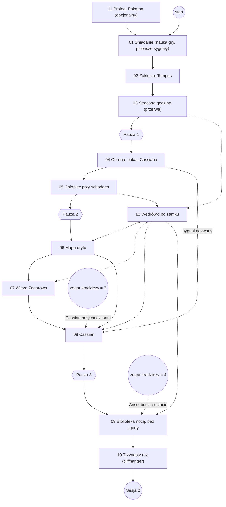

# Sesja 1: graf scen (plik pomocniczy)

Plik pomocniczy do przeglądu scenariusza `s1` (`przeglad.md` w tym samym folderze), bez nagłówka YAML. Zawiera mapę scen, warunki wejścia i wyjścia, drużynę i wspólny sekret, siatki bezpieczeństwa, punkty pauzy, zegar kradzieży, tabelę flag, zasadę trzech dróg, listę potrzebnych obiektów, pytania do MG i sprawy do weryfikacji. Prawda dla MG, stałe i elastyczne oraz rozwidlenie końcowe są w przeglądzie.

Stan: szkic po fazie 2B (2026-11-20), wszystkie pytania do MG z tej fazy rozstrzygnięte. Wprowadzone decyzje MG z 2026-11-20: Patron to Silas Wymark; godzina ginie między Zaklęciami a Obroną; inne ofiary widzą Ansela tylko mignięciem; Pokątna jako opcjonalny prolog; data 22 września 1969 (poniedziałek, sprawdzone); postacie z dowolnych domów; drużyna to mieszana grupa ćwiczeniowa Wrena plus wspólny sekret z 4. roku; przed stratą Ansel miga tylko jako odbicie w szkle zegara; z Anselem rozmawiają tylko postacie graczy, bo ich godzina jest jego kotwicą.

**Decyzja MG z 2026-11-20 (po teście obciążeniowym sceny 01): zegarka Cassiana nie da się zdobyć przed sceną 04.** Przy śniadaniu (01) i na Zaklęciach (02) zegarek jest wyłącznie sygnałem. W pokazie u Wrena (04) postać może go wyrwać, ale Wren oddaje go Cassianowi („pamiątka, nie dowód”) i zaczyna podejrzewać. Prawdziwe przejęcie: najwcześniej po scenie 04 (kradzież, targ, litość), zwykle w konfrontacji (08). Odwołuje dawną siatkę 1 („kradzież w dowolnej chwili”, także przed stratą godziny). Scena 01 trwa 30 minut zamiast 20.

**Decyzja MG z 2026-11-20, odwraca wcześniejszą (legalne wejście do biblioteki):** do Działu Ksiąg Zakazanych i pracowni Marrow postacie dostają się **wyłącznie nocą, bez zgody**. Nie ma przepustki Flitwicka ani zgody Wrena, McGonagall, Dumbledore'a czy pani Pince. Usunięte: `flaga.przepustka-flitwicka`, `flaga.biblioteka-legalnie`, `przedmiot.przepustka-flitwicka`. Dodana siatka bezpieczeństwa 9 (Filch łapie postacie w drodze do pracowni).

**Decyzje MG z fazy B2b (2026-11-20), wprowadzone:** w pracowni lewituje zaklęta księga nieznanego autora (`przedmiot.zakleta-ksiega`) ze stopniowanymi zabezpieczeniami; dawny „dziennik” to w treści **notatnik Marrow** (identyfikator `przedmiot.dziennik-marrow` bez zmian), oparty na księdze i z odsyłaczami do niej; Karta Pożyczającego pochodzi z księgi, nie z notatnika; gablota otwiera się po oddaniu godziny i ma trzy drogi do tej wskazówki (W7); zatrzymane zegary to chwile pobrania „zapłaty” w 1951; karta działa tylko z zegarkiem Cassiana (zakończenie „moc”); zniszczenie zegarka: Ansel migocze i część godzin wraca do ofiar; Klepsydra na lekcji Fairweather niejasna do Sesji 2; teasery (RETRORSUM, „Oko, które dostrzega ukryte”) odnotowane w przeglądzie.

**Zmiana numeracji (faza 2B).** Ponieważ godzina ginie teraz przed Obroną, sceny 03 i 04 zamieniły się miejscami: `s1.scena.03` to Stracona godzina, `s1.scena.04` to Obrona przed Czarną Magią. Pliki scen jeszcze nie istnieją, więc nic się nie psuje.

## Mapa scen

### Graf przejść

### Sceny: opis, wejście, wyjście, flagi

**s1.scena.11 Prolog: ulica Pokątna (opcjonalny, 30 min).** Sobota 30 sierpnia 1969, ostatnie zakupy przed szkołą (potwierdzone przez MG 2026-11-20 jako opcjonalny prolog). Postać, która potrzebuje nowej różdżki (złamana w wakacje, odziedziczona, „nie słucha”), idzie do Ollivandera; reszta kupuje podręczniki do szóstego roku. Przy witrynie „Crake i Córka” starszy pan poprawia wskazówki: tu wypada przelotna pogawędka z Crake'iem. Gazeciarz krzyczy tytuły; ktoś w kolejce szepcze plotkę. Jeśli prolog jest grany, **przejmuje rolę sceny nauczającej** (rozmowa i jeden prosty test), a scena 01 skraca się do 10 minut.
- Wejście: decyzja MG przed sesją. Brak wymaganych flag.
- Wyjście: przeskok „trzy tygodnie później” do sceny 01.
- Ustawia: `flaga.s1-prolog-pokatna`, `flaga.crake-poznany`, ewentualnie `flaga.crake-dluga-rozmowa`, `flaga.plotka-o-voldemorcie`.
- Następne: s1.scena.01.

**s1.scena.01 Śniadanie w Wielkiej Sali (30 min, nauka gry, pierwsze sygnały).** Poniedziałek 22 września 1969. Dumbledore'a nie ma przy stole nauczycieli (wyjazd do Londynu, decyzja MG 2026-11-20). Sowy, plan lekcji, rozmowa z gadatliwym kolegą z roku (pierwszy dialog: gracz mówi w imieniu postaci, MG odpowiada). **Drużyna się zbiera:** profesor Wren idzie wzdłuż stołów i zaczepia postacie po kolei, tam, gdzie siedzą: „Grupa trzecia: dziś po obiedzie, dziesięć minut przed moją lekcją, pod salą. Rozstawiacie stanowisko. Najpierw Zaklęcia. Grupa pana Vane'a już się chwaliła, że was rozniesie”. Postacie wymieniają spojrzenia przez salę (albo siadają razem na końcu jednego stołu, jeśli gracze tego chcą). Po niepokojącym lecie Wren podzielił szósty rok na mieszane grupy ćwiczeniowe, bo „wojna nie pyta o dom”; to zdanie zna cały rok i nie wszyscy je lubią (stół Slytherinu prycha). Od stołu Slytherinu dolatuje szept o „Czarnym Panu”, „śmierciożercach” i „panu Notcie, który był u ojca w wakacje”; kolega wzrusza ramionami, że to bajki. Filch, nowy woźny, przegania kogoś z sali.
**Pierwsze sygnały dziwności** (odbicie w szkle zegara zawsze, do tego MG wybiera 1–2 inne; bez zmiany fabuły; to skutki trzech tygodni kradzieży Cassiana):
- Wielki zegar w Sali Wejściowej spóźnia się o cztery minuty; dzwon na pierwszą lekcję bije „za późno”, prefekci sprawdzają własne zegarki. Jeśli prologu nie było, przy zegarze stoi Crake z drabiną (pogawędka ruchoma).
- Przy stole Hufflepuffu koleżanki dokuczają Maisie Lock, że „zasnęła z otwartymi oczami” na sprawdzianie. Maisie upiera się: „Nie spałam. Po prostu mi tego kawałka nie ma”.
- Plotka o „duchu Puchona”: pierwszoroczniacy widzieli na schodach chłopca w żółtym krawacie, który rozpłynął się, gdy go zawołali. Gruby Mnich jest urażony, że to nie o nim.
- Cassian Vane zerka na zegarek kieszonkowy, którego wskazówki stoją. **Tylko sygnał:** zegarka nie da się tu zdobyć (decyzja MG 2026-11-20; próby obsługuje plik sceny, sekcja „Gdy gracze zboczą”).
- **Odbicie w szkle zegara (decyzja MG z 2026-11-20).** Jedna postać, przechodząc obok wielkiego zegara w Sali Wejściowej (albo patrząc w szybkę zegara ściennego nad stołem nauczycieli), widzi w szkle tuż za swoim ramieniem chłopca w żółtym krawacie. Odwraca się: nikogo nie ma. W szkle też już go nie ma. To **jedyna** postać Ansela przed straconą godziną: wyłącznie odbicie w szkle zegara, nigdy na żywo (zegary są kanałami Klepsydry). Najlepiej dać je postaci, która nie wygrała testu przy stole, żeby każdy miał coś swojego. **Odbicia nigdy się nie ucina** (scena 05 go potrzebuje). Kolejność przy wyjściu: dzwon, potem odbicie, potem Crake tylko wtedy, gdy zostaje czas. Odbicia przy wielkim zegarze nie łączy się z Crake'iem na drabinie przy tym samym zegarze: wtedy odbicie idzie w szybce zegara nad stołem nauczycieli albo Crake właśnie zszedł i pakuje narzędzia z boku.
Jeden prosty test: zauważyć coś przy stole (Wits + Observation, czyli bystrość i spostrzegawczość; niski próg, liczby ustali mechanik). Sukces wskazuje jeden z sygnałów, porażka nic nie zamyka: o duchu Puchona i tak gada cały stół.
- Wejście: początek sesji albo po prologu.
- Wyjście: dzwon (spóźniony) na Zaklęcia, w drodze odbicie w szkle zegara.
- Ustawia: `flaga.plotka-o-voldemorcie`, `flaga.plotka-duch-puchona` (zawsze: Tobias o niej mówi), `flaga.ansel-odbicie`, opcjonalnie `flaga.crake-poznany`, `flaga.crake-dluga-rozmowa`. `flaga.zegarek-cassiana` się nie zmienia (zawsze `u-cassiana`).
- Następne: s1.scena.02.

**s1.scena.02 Zaklęcia: Tempus (30 min).** Flitwick uczy zaklęcia Tempus, które pokazuje prawdziwą chwilę, nie wskazania zegara (decyzja MG: Tempus to nowe zaklęcie szóstego roku, nikt go nie zna na starcie; trudność według zasady domowej ZD-21). Pierwszy test magiczny każdej postaci. **Sygnał dziwności:** gdy z Wieży Zegarowej dochodzi bicie, cyfry nad różdżką Flitwicka drżą i przeskakują o minutę; Flitwick marszczy brwi: „Wieża boczy się od dwóch tygodni, pan Filch twierdzi, że dzwony chodzą wolno”. Jeśli Cassian chodzi na Zaklęcia z postaciami, pięć minut przed końcem prosi o wyjście „do skrzydła szpitalnego” (idzie przygotować kradzież). Zegarek jest tu, jak w 01, tylko sygnałem: zdobyć go nie można (decyzja MG 2026-11-20). Flitwick zadaje pracę domową: zmierzyć przesunięcie trzech zegarów na różnych piętrach. Ciekawskim wspomina, że o dryfie czasu pisano poważnie tylko w książkach z Działu Ksiąg Zakazanych, ale przepustki nie podpisze: „Nie na ten temat i nie dla szóstego roku, moi drodzy”. To motywacja do nocnej wyprawy, nie ułatwienie (decyzja MG 2026-11-20).
- Wejście: brak warunków.
- Wyjście: koniec lekcji, przerwa obiadowa. Opuszczenie lekcji nie blokuje: praca domowa i tak dociera (kolega, Flitwick na korytarzu), a Tempus da się dopracować później (korepetycje u Flitwicka w scenie 12).
- Ustawia: `flaga.tempus-opanowane`, `flaga.praca-domowa-dryf`.
- Następne: s1.scena.03.

**s1.scena.03 Stracona godzina (15 min).** Przerwa obiadowa między Zaklęciami a Obroną. Drużyna idzie razem bocznym korytarzem: Wren kazał grupie trzeciej przyjść wcześniej i rozstawić stanowisko, więc postacie łapią coś z kuchni albo z obiadu na wynos i idą prosto pod salę Obrony. Grupa daje powód, by trzymać się razem bez względu na dom. Złote światło, mrugnięcie, dzwon na Obronę bije **od razu**: minęła godzina, obiad przepadł. Dla postaci nie minęła chwila. Świadek (Irytek albo portret przy oknie): „Staliście jak posągi, a jakiś Ślizgon z zegarkiem przeszedł obok i gwizdał”. Każda postać dostaje osobisty ślad (zadrę): list sprzed miesiąca w kieszeni, skończony esej, atrament na dłoniach, wspomnienie spotkania, na którym „była”. Jedna zadra może dotyczyć wspólnego sekretu z 4. roku (zob. niżej): w kieszeni leży rzecz z tamtego dnia, którą postać na pewno zostawiła w kufrze. Świeżo nauczony Tempus pokazuje godzinę różnicy wobec własnego zegarka. Na końcu jedna postać (ta, która się obejrzy) widzi na schodach chłopca w szacie Hufflepuffu, który znika: **mignięcie, pierwszy kontakt**. Godzinę traci cała drużyna naraz (zob. siatki bezpieczeństwa: postać, która odłączyła się od grupy, i spóźniony gracz).
- Wejście: po scenie 02 (albo w dowolnym momencie przerwy, jeśli gracze zboczyli).
- Wyjście: biegiem na Obronę, kilka minut spóźnienia (04). Jeśli gracze zamiast tego idą do skrzydła szpitalnego albo do nauczyciela, Obrona i tak się odbywa: Wren przychodzi po nich osobiście albo kolega relacjonuje pokaz Cassiana („był jak błyskawica, nikt go nie trafił”).
- Ustawia: `flaga.godzina-stracona`. Startuje `flaga.s1-zegar-kradziezy` (0).
- Następne: s1.scena.04; s1.scena.12 dostępna. **Punkt pauzy 1** po tej scenie.

**s1.scena.04 Obrona przed Czarną Magią: pokaz Cassiana (30 min).** Profesor Wren [nasze] przyjmuje spóźnionych chłodno: „Gdzie byliście?”. Grupa trzecia miała przyjść dziesięć minut wcześniej, a wpada kilka minut po dzwonie; cena spóźnienia: grupa Cassiana wybrała już lepsze stanowisko i zaczyna pierwsza (bez punktów domów). Jeśli postacie powiedzą prawdę, Wren pyta, czy Vane był w pobliżu. Lekcja: „Przeciwnik zawsze mówi, co zrobi”. **Rywalizacja grup:** każda grupa ćwiczy czytanie przeciwnika na uczniach z grupy rywali; dwóch uczniów tła z widocznymi nawykami (Rosalind Teague, Barnaby Finch, oboje w grupie Cassiana) to pierwsza nauka testu przeciwnego. Potem pokaz grup: Cassian, wypoczęty i spokojny, występuje za swoją grupę i walczy z jedną z postaci i działa dwa razy, zanim ona skończy jeden ruch, po czym dotyka kieszonki kamizelki. Jego grupa wygrywa, Wren chwali ją przed całym rokiem. **Zegarek w pokazie (decyzja MG 2026-11-20).** Postać, która patrzy na pokaz (walcząca albo z boku), robi test spostrzegawczości (Wits + Observation; liczby ustali mechanik): sukces ujawnia, że Cassian korzysta z zegarka (dotyk kieszonki tuż przed każdym podwójnym ruchem, ciepło szkła, tykanie, którego nie powinno być). To pierwsza droga do W4 i podstawa `flaga.sygnal-cassiana-nazwany`, gdy postać powie to na głos. Postać, która pokona Cassiana w pokazie, może wyrwać mu zegarek; Wren natychmiast go odbiera i oddaje Cassianowi („pamiątka, nie dowód”), ale od tej chwili podejrzewa (`flaga.wren-podejrzewa`). Zegarek zostaje `u-cassiana`; zegar kradzieży biegnie dalej. Prawdziwe przejęcie zegarka dopiero w scenie 08 (albo kradzież po lekcji, zob. siatka 1). **Nowy sens w świetle straty:** postacie, głodne, zmęczone i wybite z rytmu, patrzą na kogoś, kto ma godzinę za dużo; Tempus rzucony przy Cassianie tyka szybciej niż gdziekolwiek. Kto nazwie sygnał na głos, ma przewagę w scenie 08. Po lekcji Wren może rzucić uwagę o ocenach Vane'a. Czy stracona godzina daje postaciom stan Drained (wyczerpanie, +3 do trudności, decyzja MG z 2026-11-19) już w tej scenie, ustala mechanik.
- Wejście: brak warunków (zwykle po 03).
- Wyjście: koniec lekcji, korytarz, wieczór.
- Ustawia: `flaga.sygnal-cassiana-nazwany`, opcjonalnie `flaga.wren-podejrzewa` (wyrwany zegarek albo jego uwaga o ocenach Vane'a).
- Następne: s1.scena.05, s1.scena.12; s1.scena.08 możliwa od razu, jeśli gracze konfrontują Cassiana po lekcji.

**s1.scena.05 Chłopiec przy schodach (25 min).** Wieczorem, u stóp cichych schodów przy kuchni, Ansel pyta, która godzina, bo „pani profesor Marrow kazała czekać przy schodach”. Rozmawiać z nim mogą wszystkie postacie graczy, które straciły godzinę, i tylko one: ich wspólnie zabrana godzina stała się jego kotwicą (MG to wie, gracze dowiedzą się z notatnika w Sesji 2). Postać, która rano widziała odbicie w szkle zegara, rozpoznaje chłopca; Ansel: „Widziałem panią/pana w zegarze. Wszyscy w zegarach są tacy daleko”. Ansel może mimochodem dotknąć wspólnego sekretu z 4. roku (zob. niżej). Przechodzący uczniowie go nie zauważają; ktoś, kto też stracił godzinę (np. Maisie Lock), zatrzymuje się, mruga i idzie dalej: „Zdawało mi się…”. Życzliwość (jedzenie, słuchanie, imię, którego może się trzymać) buduje Więź; nieuprzejmość płoszy go na resztę wieczoru. Tempus przy Anselu nie formuje cyfr; ręka przechodzi przez beczkę przy wejściu do Hufflepuffu. **Teaser:** gracze, którzy spotkali Ansela w escape roomie przed kampanią, mogą go tu rozpoznać (albo już w odbiciu w scenie 01). Ansel nie pamięta tamtego spotkania, ale ma wrażenie, że ich zna (decyzja MG 2026-11-20): patrzy uważnie i mówi tylko: „Może. Ja dużo czekam, to dużo widzę”. **Wczesna droga do W7:** jeśli ktoś pyta o panią profesor, Ansel może powtórzyć jej powiedzonko o szafce, która „najpierw chce dostać” (zob. W7.3).
- Wejście: `flaga.godzina-stracona`.
- Wyjście: Ansel znika, gdy ktoś nadchodzi, albo zostaje „przy schodach”. Gracze mogą od razu pójść z nim do nauczyciela albo do Dumbledore'a (siatka bezpieczeństwa 3).
- Ustawia: `flaga.ansel-spotkany`, `flaga.ansel-kontakt` (+1 za każdą postać, która rozmawia z nim **pierwszy raz**), opcjonalnie `flaga.ansel-poza-spisem`, `flaga.marrow-imie-znane`, `flaga.dumbledore-powiadomiony`, `flaga.sekret-poruszony`.
- Następne: s1.scena.06 albo s1.scena.12. **Punkt pauzy 2** po tej scenie.

**s1.scena.06 Mapa dryfu (30 min, węzeł śledztwa).** Wtorek 23 września. Praca domowa na serio. Gracze wybierają miejsca w zamku (minimum trzy, maksimum sześć przy początkujących) i porównują chwilę prawdziwą z zegarami. Dwa wzory: gładkie spóźnienia rosnące ku Wieży Zegarowej (przypływ) i drżące odczyty prowadzące do lochów (ktoś podbiera). Boczna droga: rozpytać uczniów, którzy też stracili godziny, i dopasować je do nagłych sukcesów Cassiana; przy okazji ofiary opowiadają o swoim mignięciu „ducha Puchona”. Każde miejsce może być małą scenką z modułu 12.
- Wejście: `flaga.godzina-stracona` (praca domowa daje pretekst, ale nie jest konieczna).
- Wyjście: gracze idą za przypływem (07) albo za śladem (08). Obie kolejności działają.
- Ustawia: `flaga.przyplyw-ku-wiezy`, `flaga.slad-ukaszen`, `flaga.rejestr-godzin`.
- Następne: s1.scena.07, s1.scena.08, s1.scena.12.

**s1.scena.07 Wieża Zegarowa (20 min).** Wszystko wskazuje tutaj, a wieża jest doskonała: zero przesunięcia, mechanizm bez skazy. Celowy ślepy zaułek: gracze udowadniają, że odpowiedź leży gdzie indziej. Ziarno: świeży olej i mosiężna plakietka „Konserwacja: Crake i Córka, ulica Pokątna”. Za dnia Crake może właśnie schodzić z wieży (pogawędka ruchoma). O zmierzchu przychodzi tu Cassian podbierać czas: naturalne przejście do 08. Ansel nie chce wejść na wieżę (boi się dzwonu; zginął, spadając z niej, ale tego nie pamięta).
- Wejście: brak twardych warunków (gracze mogą przyjść z ciekawości).
- Wyjście: do 08 (Cassian przychodzi albo trop prowadzi do niego) lub z powrotem do 06/12.
- Ustawia: `flaga.wieza-zbadana`, `flaga.plakietka-crake`, opcjonalnie `flaga.crake-poznany`.
- Następne: s1.scena.08, s1.scena.06, s1.scena.12.

**s1.scena.08 Cassian (35 min).** Drogi do konfrontacji: sygnał z kieszonki, dopasowane godziny, ślad drżących zegarów do przejścia Slytherinu, wspólne dormitorium (siatka bezpieczeństwa 5) albo Cassian sam ich znajduje. Jest chłodny, potem roztrzęsiony; jako lider rywalizującej grupy zna postacie z ćwiczeń u Wrena i może sięgnąć po wspólny sekret z 4. roku jako kartę przetargową (zob. niżej). Proponuje formalny pojedynek: jeśli przegra, powie, skąd ma kartę. **Przejęcie zegarka** (decyzja MG 2026-11-20: tu jest jego właściwe miejsce) czterema drogami: wygrany pojedynek (zegarek jako stawka albo wytrącony z ręki), kradzież (test przeciwny, liczby w karcie [[przedmiot.zegarek-cassiana]]), targ (np. milczenie postaci za zegarek albo za kartę) i litość (roztrzęsiony Cassian oddaje go sam, gdy ktoś szczerze mu pomoże). Wcześniejszy test spostrzegawczości (04 albo tu, przy pierwszym spojrzeniu) mówi postaciom, że to zegarek, a nie Cassian, jest źródłem szybkości. Inne wyniki: donos do Wrena (brak dowodów, ale Wren zaczyna patrzeć; jeśli `flaga.wren-podejrzewa`, słucha uważniej), **zniszczenie zegarka** (Ansel na chwilę migocze, gdziekolwiek jest, część skradzionych godzin wraca do ofiar, np. Maisie nagle pamięta swój kwadrans, ale godzina drużyny nie wraca, bo jest kotwicą Ansela; zegar kradzieży staje; `flaga.zegarek-cassiana` = `zniszczony`). Każdy wynik prowadzi do 09 (zob. drogi awaryjne do pracowni).
**Co Cassian wie o pracowni (gdy mówi):** księga wisi nad pulpitem, zagadek nie umiał rozwiązać, więc wyrwał kartę; „wszystko się obudziło”, wahadła, zegary, schody, ledwo zdążył (oparzona dłoń, którą chowa w rękawie, to dowód bez słów). O gablocie: „Próbowałem ją okraść. Szkło zmatowiało pod ręką. Ona nie daje się brać”. To ostrzeżenie przed księgą (W10) i odwrotna podpowiedź do gabloty (zapasowa droga do W7). **Karta i zegarek:** karta działa tylko z zegarkiem Cassiana (decyzja MG); gracze, którzy zdobędą oba i ich użyją, wchodzą w zakończenie „moc” (przegląd).
- Wejście: co najmniej jedna z flag `flaga.sygnal-cassiana-nazwany`, `flaga.slad-ukaszen`, `flaga.rejestr-godzin`, `flaga.wieza-zbadana` **albo** `flaga.s1-zegar-kradziezy` = 3 (Cassian przychodzi sam) **albo** zegarek jest u graczy po kradzieży po scenie 04 (Cassian przychodzi po niego).
- Wyjście: lokalizacja pracowni z ust Cassiana albo jedna z dróg awaryjnych.
- Ustawia: `flaga.cassian-zdemaskowany`, `flaga.cassian-los`, `flaga.zegarek-cassiana`, `flaga.karta-u-graczy`, `flaga.lokalizacja-pracowni`, opcjonalnie `flaga.sekret-poruszony`.
- Następne: s1.scena.09. **Punkt pauzy 3** po tej scenie.

**s1.scena.09 Biblioteka: trzynaste drzwi i Sala Zatrzymanych Godzin (40 min).** **Wejście tylko nocą, bez zgody** (decyzja MG 2026-11-20). Żaden nauczyciel nie podpisze przepustki do Działu Ksiąg Zakazanych na ten temat, a pani Pince nie wpuszcza uczniów za sznur; złamanie regulaminu jest konieczne.
- *Wyprawa:* po ciszy nocnej postacie wymykają się z dormitoriów (Ansel może iść przodem jako zwiadowca: jego nikt nie widzi). Jeden test skradania (przeciwnik: obchód Filcha; liczby ustali mechanik). Porażka nie blokuje wejścia, tylko zmienia cenę: obchód Filcha przychodzi wcześniej (kandydat: Zegar Północy, decyzja mechaniczna czeka), postacie muszą się chować i tracą minuty albo zostawiają ślad (zgaszona lampa, przestawiony sznur, okruchy), który pani Pince znajdzie rano (plotka i podejrzliwość, bez kary). Złapanie w drodze: siatka bezpieczeństwa 9.
- *Pani Pince nocą nie patroluje* (decyzja wykonawcza): biblioteka jest zamknięta, a ona śpi w swoich pokojach. Jej rola w Sesji 1 to dzień (rejestr wypożyczeń, scena 12) i poranek po wyprawie (ślady).
W ostatnim rzędzie przycisk do książek w kształcie klepsydry i drzwi otwierane „godziną, której nie ma”. Na dole Sala Zatrzymanych Godzin. **Najwyżej dwie przeszkody obowiązkowe:** (1) drzwi (W6), (2) gablota z notatnikiem, która otwiera się, gdy ktoś godzinę odda (W7). Galeria wahadeł to **cena, nie bramka**: jeden test grupowy, porażka kosztuje hałas, czas albo zadrapanie, ale przejście jest zawsze. Ściana z zakazaną lekcją pożyczania chwili to opcjonalna pokusa. Ślad Patrona: obok kredowego podpisu Marrow drugie inicjały „S.W.” (nic więcej; nikt nie zna tego nazwiska).
- **Zaklęta księga** (`przedmiot.zakleta-ksiega`, decyzja MG 2026-11-20). Pośrodku sali, nad ozdobnym drewnianym pulpitem czytelniczym, lewituje otwarta księga w niebieskawej łunie. Widać w niej poszarpany pasek po wyrwanej karcie; kto ma Kartę Pożyczającego, widzi, że krawędź pasuje. Nie da się jej zabrać ani przewrócić strony. Patrzenie jest bezpieczne i nie wymaga testu. Pod pulpitem osmalone kamienie i rozmazane, biegnące ślady w kurzu (ucieczka Cassiana): ostrzeżenie bez słów (W10). **Księga nie jest przeszkodą obowiązkową;** w Sesji 1 to obraz, pokusa i ziarno zagadek na Sesję 2.
- **Stopniowanie zabezpieczeń** (`flaga.ksiega-zabezpieczenia`, 0–3; liczby obrażeń i testów w karcie [[przedmiot.zakleta-ksiega]]). Dotyk ręką, różdżką, zaklęciem przyciągającym albo próba przewrócenia strony liczy się jako dotknięcie.
  - *Poziom 1, pierwsze dotknięcie:* delikatne porażenie, mrowienie do łokcia, łuna ciemnieje, wszystkie zatrzymane zegary tykają raz, naraz. Bez obrażeń; to sygnał.
  - *Poziom 2, każde kolejne dotknięcie:* silniejsze porażenie (lekkie obrażenia, odrzut, upuszczona różdżka), wahadła w galerii zaczynają się kołysać same, hałas. Każde następne dotknięcie na tym poziomie mocniej. Ansel (jeśli jest) krzyczy, żeby przestali. **Przed próbą przejścia na poziom 3 MG mówi wprost, poza fikcją:** „To jest to, co zrobił Cassian. Jeśli spróbujecie wyrwać kartkę, pracownia się obudzi i jedynym wyjściem będzie ucieczka”.
  - *Poziom 3, próba wyrwania kartki albo siłowego zabrania księgi:* pełne zabezpieczenia. **Kartka nie puszcza w całości:** w dłoni zostaje róg kartki z jednym znakiem, przydatnym przy zagadkach w Sesji 2 (decyzja MG 2026-11-20). Zatrzymane zegary ruszają wszystkie naraz, a pracownia zaczyna bić trzynaście uderzeń: po trzynastym schody się zamykają. Scena akcji ucieczki (ok. 5–10 min): powrót przez galerię wahadeł, które teraz tną szybko, i po tykających schodach do drzwi w bibliotece. Trzy odcinki, każdy to test grupowy (liczby w karcie [[przedmiot.zakleta-ksiega]]). Porażka dokłada cenę: uderzenie zegara (bliżej zamknięcia), obrażenia albo upuszczoną rzecz, ale **droga do wyjścia jest otwarta, dopóki nie wybije trzynaste uderzenie**. Kto nie zdąży: siatka bezpieczeństwa 8. Hałas sięga biblioteki: Filch na obchodzie zatrzymuje się i nasłuchuje.
  - Po ucieczce pracownia uspokaja się po kilku minutach i znów da się wejść, ale księga „pamięta”: następne dotknięcie w tej sesji zaczyna od poziomu 2.
- **Gablota i trzy drogi do W7.** Gablota z notatnikiem otwiera się po **oddaniu** godziny; postacie są do tego naprowadzane trzema niezależnymi drogami (tabliczka, dopisek na karcie, Ansel) i drogami zapasowymi (szkic w notatniku widoczny przez szkło, Tempus pokazujący lukę 60 minut, a na końcu podpowiedź Cassiana); szczegóły w tabeli trzech dróg (W7). Siłowe otwarcie gabloty **nie** uruchamia zabezpieczeń księgi (jest osobnym mechanizmem): działa, ale z ceną (część notatnika rozmyta, hałas).
- **Czas:** obejrzenie księgi mieści się w 40 minutach sceny. Ucieczka przed pełnymi zabezpieczeniami dodaje 5–10 minut tylko wtedy, gdy gracze ją wywołają; MG odzyskuje je, pomijając galerię wahadeł w drodze w dół albo skracając scenę 10.
- Wejście: `flaga.lokalizacja-pracowni` albo dotarcie drogą awaryjną (Tempus przy półkach, rejestr wypożyczeń, śledzenie Cassiana, zegar kradzieży 4). Zawsze nocą, po ciszy nocnej.
- Wyjście: z notatnikiem albo bez (każdy wariant prowadzi do 10).
- Ustawia: `flaga.pracownia-otwarta`, `flaga.ksiega-zabezpieczenia`, opcjonalnie `flaga.ksiega-zlapani`, `flaga.pozyczona-chwila-poznana`, `flaga.gablota-sposob`, `flaga.dziennik-u-graczy`, `flaga.dziennik-miejsce`, `flaga.wymark-slad`, `flaga.filch-zlapal`.
- Następne: s1.scena.10.

**s1.scena.10 Trzynasty raz (15 min, cliffhanger).** Gdy notatnik przekracza próg pracowni, każdy zegar w zamku bije trzynaście razy; trzynaste uderzenie nie powinno istnieć. Portrety budzą się, Irytek wyje. Ansel, który był z nimi albo czekał przy schodach, zaczyna blednąć: „Zrobiło się ciszej. Nie podoba mi się to”. Bicie zwabia Filcha; jeśli złapie postacie z notatnikiem, zabiera go (siatka bezpieczeństwa 4), ale trzynasty raz już wybił. Krótki epilog dla MG: w Londynie zegarmistrz podnosi głowę znad warsztatu. MG zadaje pytanie: **„Co robicie z notatnikiem i z Anselem?”** i kończy sesję (albo pozwala na pierwszą wymianę zdań, jeśli czas pozwala).
- Wejście: wyjście z 09 (z notatnikiem albo bez, zob. warianty awaryjne w przeglądzie).
- Ustawia: `flaga.trzynasta-wybila`, `flaga.s1-wybor` (zwykle `nierozstrzygniety` na koniec sesji), ewentualnie `flaga.filch-zlapal`, `flaga.dziennik-miejsce`.
- Następne: Sesja 2 (`brak` w tym scenariuszu).

**s1.scena.12 Wędrówki po zamku (moduł spotkań, 5–30 min).** Zestaw krótkich spotkań do wpięcia, gdy gracze chcą chodzić po zamku: kuchnia i skrzaty; Gruby Mnich (duch Hufflepuffu, obrażony plotką o „duchu Puchona”); portret przy schodach; nauczyciel astronomii [nasze] z lunetą i wspomnieniem „pani Marrow”; pokój wspólny; dormitorium (siatka bezpieczeństwa 5); sowiarnia; Filch na obchodzie; pierwszoroczniak, który zemdlał na schodach (ofiara Cassiana, widział „ducha” mignięciem); Maisie Lock i Gideon Pratt (straciły godziny); pani Pince skarżąca się na „chłopca od Slughorna” wypożyczającego książki o zegarmistrzostwie; korepetycje z Tempus u Flitwicka (o Dział Ksiąg Zakazanych pytany odmawia, zob. scena 02); gabinet dyrektora (siatka bezpieczeństwa 3). Każde spotkanie daje jedną drogę do wskazówki z tabeli trzech dróg albo moment z Anselem.
- Wejście: po `flaga.godzina-stracona`; przed nią tylko jako kolor.
- Wyjście: powrót do sceny, z której gracze wyszli, albo do następnej w grafie.
- Ustawia: dowolne flagi śledztwa zgodnie z tabelą trzech dróg; `flaga.ansel-kontakt` (spotkanie wyrównujące); `flaga.dumbledore-powiadomiony`. Prośba do nauczyciela o wejście do Działu Ksiąg Zakazanych zawsze kończy się odmową (bez kary; czasem z uważnym spojrzeniem).

### Sceny elastyczne: jak je wpiąć bez psucia ciągu

- **Prolog na Pokątnej (11)** ma jedno miejsce: przed sceną 01, jako „trzy tygodnie wcześniej”. Nie wraca w środku tygodnia szkolnego. Daje to samo co scena 01 (nauka gry, plotka, Crake), więc gdy jest grany, scena 01 kurczy się do sowiej poczty, jednego sygnału dziwności i jednego zdania plotki. Gdy nie jest grany, nic nie ginie: Crake pojawia się w zamku, a różdżka może być „nowa od Ollivandera” w opisie postaci. Gracz, który bardzo chce wyprawy po różdżkę w środku sesji: różdżka pęka w scenie 02 albo 08, McGonagall załatwia wyjście przez kominek w sobotę, czyli **po** Sesji 1 (otwarcie Sesji 2).
- **Wędrówki po zamku (12)** to spotkania wielkości 5 minut: jedno spotkanie = jedna wskazówka albo jeden moment z Anselem albo czysty kolor. Zegar kradzieży rośnie o 1 za każde pół dnia w fikcji, więc długie wędrówki nie zatrzymują świata.
- **Pogawędka ruchoma z Crake'iem.** Crake pojawia się raz, w pierwszym pasującym miejscu: prolog 11 (witryna sklepu), scena 01 (drabina przy wielkim zegarze) albo scena 07 (schodzi z wieży). Test spostrzegawczości (Wits + Observation; próg ustali mechanik). Zwykły sukces: miły starszy pan, pachnie olejem, „wieża ostatnio wymaga więcej uwagi”. **Tylko bardzo wysoki wynik** (propozycja: poziom Walkera „Impressive success”, co najmniej dwa razy trudność, Walker 2e s. 3; do potwierdzenia przez mechanika): postać zauważa zdjęcie dziewczyny w kopercie jego zegarka; Crake mówi chwilę dłużej o córce, która „pomagała mu w sklepie”. Crake niczego nie zdradza o Klepsydrze ani o „kliencie z Londynu”.

## Drużyna: grupa Wrena i wspólny sekret (decyzja MG z 2026-11-20)

### Na co dzień: grupa trzecia u profesora Wrena

Po niepokojącym lecie 1969 profesor Wren podzielił szósty rok na Obronie przed Czarną Magią na stałe grupy ćwiczeniowe z różnych domów: „wojna nie pyta o dom”. Postacie graczy są w jednej grupie (roboczo „grupa trzecia”; MG może ją nazwać inaczej). Cassian Vane prowadzi grupę rywalizującą, w której są też Rosalind Teague i Barnaby Finch. Grupy ćwiczą razem, przychodzą razem na zajęcia i rywalizują w pokazach, bez punktów domów.

Co to daje w scenach:
- **01:** Wren zaczepia postacie przy śniadaniu i umawia grupę przed lekcją; rywalizacja z grupą Vane'a zapowiedziana od rana.
- **02–03:** drużyna wychodzi z Zaklęć razem i razem idzie wcześniej pod salę Obrony, więc razem traci godzinę. Nikt nie musi wymyślać pretekstu.
- **04:** spóźniona grupa oddaje rywalom lepsze stanowisko; pokaz Cassiana to zwycięstwo jego grupy na tle zmęczenia postaci.
- **06–08:** grupa ma prawo ćwiczyć razem po lekcjach w pustej sali Obrony (wygodny punkt zborny i baza śledztwa); Wren pyta „swoją” grupę, kto ostatnio gubi czas, zanim zapyta publicznie.
- **Sesja 2 i dalej:** grupa trwa cały rok, więc drużyna nie potrzebuje nowego powodu.

### Głębiej: wspólny sekret z 4. roku

Postacie łączy coś, co wydarzyło się dwa lata temu, na czwartym roku (1967/1968). **Treść ustalają gracze przy tworzeniu postaci; scenariusz jej nie narzuca.** MG pilnuje tylko, żeby sekret mieścił się w liniach i zasłonach ustalonych przy stole i żeby nie wymagał rozwiązania w Sesji 1.

**Pytania startowe dla graczy** (zadawane wspólnie po stworzeniu postaci, 10 minut):
1. Co się wtedy stało? Opowiedzcie to razem w dwóch, trzech zdaniach.
2. Co wtedy zrobiłeś, czego inni ci nie zapomną (na dobre albo na złe)?
3. Czego wtedy się baliście? Czy to wciąż czasem wraca?
4. Kto o tym wie poza wami? I kto nie może się dowiedzieć?
5. Jaka mała rzecz z tamtego dnia została u ciebie (przedmiot, blizna, słowo)?

**Zapis.** Odpowiedzi MG zapisuje jako zwykły tekst (kilka zdań) przy kartach postaci albo w notatce kampanii; nie są flagą. To, czy sekret padł w grze, mówi `flaga.sekret-poruszony`.

**Gdzie MG może do niego nawiązać w Sesji 1** (wybiera 1–2, wszystko nieobowiązkowe):
- **Zadra w scenie 03.** Jedna z osobistych zadr to rzecz z odpowiedzi na pytanie 5: leży w kieszeni, choć postać zostawiła ją w kufrze. Nie ustawia flagi, to tylko dreszcz.
- **Ansel w scenie 05 albo 12.** Ponieważ Ansel jest „utkany” z ich wspólnej godziny, nosi jej okruchy. Mówi mimochodem coś, czego nie może wiedzieć: słowo, rzecz albo strach z odpowiedzi na pytania 3 i 5 („Wy też się wtedy baliście, prawda?”). Sam nie wie, skąd to ma. To zapowiedź kotwicy, którą w Sesji 2 zacznie wyjaśniać notatnik (pełniej razem z księgą). Ustawia `flaga.sekret-poruszony`.
- **Cassian w scenie 08.** Zna postacie z rywalizacji grup i jest jedną z osób z odpowiedzi na pytanie 4 („kto o tym wie”) albo blefuje, że wie. Używa tego w targu albo jako groźby („Ja wiem o waszym, wy o moim”). Ustawia `flaga.sekret-poruszony`. Jeśli gracze wskazali, że nikt spoza drużyny nie wie, Cassian tylko blefuje, a test przeciwny czytania przeciwnika (jak u Wrena) to ujawnia.
- *Kolor, opcjonalnie w module 12:* Filch, nowy woźny, przegląda księgę szlabanów po poprzedniku i z satysfakcją czyta na głos wpis sprzed dwóch lat z nazwiskami postaci (tylko jeśli sekret wiązał się z przyłapaniem).

## Kontakt z Anselem

### Kto widzi Ansela (decyzja MG z 2026-11-20)

| Kto | Co widzi | Uwagi |
|---|---|---|
| Postacie graczy (przed sceną 03) | Tylko odbicie w szkle zegara, nigdy na żywo | Wczesny sygnał w scenie 01 (decyzja MG z 2026-11-20) |
| Postacie graczy (po scenie 03) | W pełni: rozmawiają z nim, on z nimi | Jedyni rozmówcy Ansela, bo ich wspólnie zabrana godzina stała się jego kotwicą (wyjaśnia notatnik w Sesji 2) |
| Inne ofiary Cassiana (Maisie Lock, Gideon Pratt, pierwszoroczniacy) | Tylko mignięcie: chłopiec w żółtym krawacie, znika, gdy się odwrócić | Źródło plotki o „duchu Puchona”; nikt nie zamienia z nim słowa |
| Reszta zamku, w tym Dumbledore | Nic | Dumbledore'a magia czasu nie dotyka |

### Kontakt każdej postaci (stopniowo, liczony osobno)

MG prowadzi na kartce przy każdej postaci jeden znacznik: **brak → mignięcie → rozmowa**. `flaga.ansel-kontakt` to liczba postaci ze znacznikiem „rozmowa”; postać liczy się raz, choćby rozmawiała z Anselem wiele razy. Więź (kandydat: tracker 0–3 na postać) prowadzi się osobno i rośnie za życzliwość, nie za rzut.

| Stopień | Gdzie | Kto | Co się dzieje |
|---|---|---|---|
| 0. Odbicie (nie liczy się do znacznika) | 01 | jedna postać | chłopiec w szkle zegara za ramieniem, za plecami nikogo |
| 1. Mignięcie | 03 | jedna postać | chłopiec na schodach, znika |
| 2. Rozmowa | 05, 12 | każda postać osobno | pierwsza rozmowa; +1 do `flaga.ansel-kontakt` tylko za postać, która rozmawia pierwszy raz |
| 3. Towarzyszenie | 06, 07, 12 | postać z najwyższą Więzią albo ta, której Tempus „tyka” po porażce kompromitującej | Ansel idzie z nią, pomaga przy jednej wskazówce |
| 4. Blednięcie | 10 | wszyscy | Ansel słabnie; ważą się wybory |

**Siatka bezpieczeństwa.** Jeśli przed sceną 09 `flaga.ansel-kontakt` jest mniejsza niż liczba graczy (gracz spóźniony, drużyna rozdzielona, postać obraziła Ansela), MG wpina **spotkanie wyrównujące** z modułu 12 dla każdej brakującej postaci: Ansel czeka na nią sam, np. siedzi na jej łóżku o świcie, stoi przy jej ławce w sali albo idzie za tykaniem jej zaklęcia. 5 minut, jedna rozmowa.

## Siatki bezpieczeństwa (poprawki z testu symulatora)

1. **Gracze chcą zabrać zegarek Cassiana wcześnie** (przepisane po decyzji MG z 2026-11-20; odwołuje dawną kradzież „w dowolnej chwili”). *Przed sceną 04 (śniadanie, Zaklęcia, przerwa) zegarka zdobyć się nie da:* Cassian trzyma go w zaciśniętej dłoni albo w zapiętej kieszonce, nie odstępuje stołu Slytherinu, próba kończy się chwyceniem ręki, uwagą prefekta albo nauczyciela; donos nic nie daje („rodzinna pamiątka, nie chodzi”), a nauczyciel niczego nie konfiskuje. Cena próby: Cassian zna twarz postaci i w 04 i 08 jest wobec niej czujny. `flaga.zegarek-cassiana` zostaje `u-cassiana`, stracona godzina (03) i pokaz (04) idą bez zmian. *W scenie 04:* postać, która pokona Cassiana w pokazie, może wyrwać zegarek, ale Wren odbiera go i oddaje Cassianowi; skutkiem jest `flaga.wren-podejrzewa`, nie zmiana właściciela. *Po scenie 04:* kradzież (np. w dormitorium Slytherinu, siatka 5), targ albo litość są możliwe; zegarek u graczy zatrzymuje zegar kradzieży, a Cassian sam przychodzi po niego jeszcze tego wieczoru albo nazajutrz (wejście do 08). Konkretne testy kradzieży i ich ceny: karta [[przedmiot.zegarek-cassiana]]; ruchy graczy w scenach 01 i 02: sekcje „Gdy gracze zboczą” w plikach scen.
2. **Spóźniony gracz** (dołącza do stołu po scenie 03). Jego postać straciła godzinę w tej samej minucie co reszta, ale poza kadrem (w innym korytarzu, w łazience, w sowiarni). Gracz dostaje od MG jedną zadrę i od razu spotkanie wyrównujące z Anselem (5 minut), zanim dołączy do drużyny. Postać, która w scenie 03 odłączyła się od grupy, traci godzinę tak samo, bo drużynę bierze się naraz.
3. **Dumbledore i niewidzialny Ansel.** Jeśli postacie przyprowadzą Ansela do gabinetu dyrektora: Dumbledore słucha uprzejmie i uważnie, proponuje Anselowi krzesło, patrzy jednak o pół metra obok. Mówi, że wierzy, iż oni kogoś widzą, i prosi o obserwację, ale niczego nie obiecuje (zajmują go większe sprawy). Ansel cicho: „On mnie nie widzi. Pani profesor też w końcu przestała”. Ustawia `flaga.dumbledore-powiadomiony`. Skutek: brak kary; o Dział Ksiąg Zakazanych pytany odpowiada uprzejmie, że regulamin obowiązuje wszystkich, także ciekawych, i zgody nie daje; Sesja 2 zaczyna się od tego, że Dumbledore „zapamiętał”.
4. **Filch łapie postacie z notatnikiem.** Trzynasty raz wybija na progu pracowni, zanim ktokolwiek je złapie; to bicie zwabia strażnika. Notatnik zostaje skonfiskowany (`flaga.dziennik-miejsce` = `skonfiskowany`, trafia do McGonagall albo szuflady Filcha), postacie dostają szlaban, `flaga.filch-zlapal`. Cliffhanger nie ginie, zmienia się tylko pytanie (zob. przegląd, rozgałęzienie „skonfiskowany”).
5. **Postać ze Slytherinu w dormitorium Cassiana.** Chłopiec ze Slytherinu na szóstym roku śpi w jednym dormitorium z Cassianem. Daje to dodatkową drogę do W4 (Cassian nocą nakręca stojący zegarek za zaciągniętą kotarą, mamrocze liczby) i okazję do kradzieży zegarka, **ale dopiero od wieczoru po scenie 04** (decyzja MG 2026-11-20; noc przed śniadaniem 01 nie jest grana, a dormitorium przed 03 nie daje kradzieży). Żeby nie skracać śledztwa: Cassian śpi z zegarkiem pod poduszką i kartą w podszewce kufra (test, porażka budzi go i robi z niego czujnego przeciwnika). Dziewczyna ze Slytherinu ma to samo w pokoju wspólnym w mniejszej skali (Cassian siedzi do późna przy kominku z zegarkiem w dłoni).
6. **Zegar kradzieży = 4, a postacie śpią.** Ansel budzi postać z najwyższą Więzią (siedzi na jej łóżku: „Ktoś poszedł do pani profesor. Tam, gdzie książki”); jeśli nikt nie ma Więzi, budzi je bicie zegarów, które o tej porze nie powinno się odezwać, a Tempus postaci przy łóżku tyka. Postać ze Slytherinu słyszy, że Cassian wychodzi. Scena 09 z Cassianem w środku.
7. **Gracze unikają Obrony** (skrzydło szpitalne, gabinet nauczyciela). Pokaz Cassiana dociera relacją kolegi; sygnał z kieszonki przechodzi do sceny 08 jako coś, co postacie widzą na żywo przy pierwszym spotkaniu.
8. **Pełne zabezpieczenia księgi łapią postać** (nie zdążyła przed trzynastym uderzeniem; `flaga.ksiega-zlapani`). Porażka kosztuje, ale nie zatrzymuje gry. Postać budzi się na podłodze w ostatnim rzędzie Działu Ksiąg Zakazanych (pracownia ją „wypluła”), z ciężkimi obrażeniami (stan Bloodied, potem Shaken do końca Sesji 1; liczby w karcie [[przedmiot.zakleta-ksiega]]; skrzydło szpitalne na noc i dzień) i **zaklęciem zapomnienia** na ostatnie minuty w pracowni: nie pamięta księgi ani ucieczki. Informacja nie ginie: pamiętają ją pozostałe postacie, a gdy złapana jest cała drużyna, pamięta Ansel („Byliście na dole. Wróciliście inni”) i zostaje rzecz w dłoni (kreda, strzęp łuny na skórze, karta). Cena: czas (zegar kradzieży +1), znalezienie przez Filcha na obchodzie (`flaga.filch-zlapal`), skrzydło szpitalne i pytania nauczycieli. Jeśli notatnik był już w ręku, pracownia wypluwa go razem z postacią: przekracza próg i trzynasty raz wybija (scena 10); jeśli nie, zostaje w gablocie (wariant awaryjny cliffhangera w przeglądzie). Grę zapomnienia MG uzgadnia z graczem na kartce. **Śmierć postaci** tylko jako świadomy wybór gracza: gdy postać po wyraźnym ostrzeżeniu poza fikcją zostaje albo wraca do księgi przy pełnych zabezpieczeniach, MG pyta jeszcze raz: „Jeśli zostanie, może zginąć. Na pewno?”. Linie i zasłony ustalone przy stole mają pierwszeństwo.
9. **Filch łapie postacie w drodze do pracowni** (nocna wyprawa przed drzwiami w ostatnim rzędzie; skutek decyzji MG z 2026-11-20 o wejściu wyłącznie nocą). Złapanie kosztuje, ale nie zamyka drogi. *Część drużyny złapana:* reszta chowa się między regałami (kryjówki w karcie [[miejsce.biblioteka]]); złapana postać może świadomie odciągnąć Filcha („To ja sam, panie woźny”), bierze na siebie szlaban i utratę reputacji, a reszta wchodzi. *Złapani wszyscy:* Filch prowadzi ich do opiekunów domów, szlaban, `flaga.filch-zlapal`, zegar kradzieży +1. Noc się nie kończy: po północy, gdy Filch, zadowolony z połowu, pisze raport w swoim kantorku, Ansel siada na łóżku postaci z najwyższą Więzią („Pan woźny śpi nad papierami. Teraz jest cicho”); jeśli zegar kradzieży doszedł do 4, działa siatka 6 (Cassian idzie pierwszy). Druga próba idzie bez testu skradania, ale z ceną: mniej czasu przed świtem (MG skraca galerię wahadeł) i szlaban już wisi nad postaciami. Jeśli gracze nie chcą drugiej próby tej nocy, następnej nocy działa siatka 6: gdy zegar kradzieży jeszcze biegnie (zegarek u Cassiana, Cassian niezdemaskowany), dochodzi do 4 i Cassian idzie pierwszy; gdy zegar stoi (zwykle po scenie 08), Ansel sam budzi postać z najwyższą Więzią i scena 09 idzie bez Cassiana w środku. Notatnik nie jest wtedy skonfiskowany: o konfiskacie mówi wyłącznie `flaga.dziennik-miejsce` (siatka 4).

## Punkty pauzy

| Pauza | Po scenie | Zegar przy stole (z wprowadzeniem 15 min) | Zdanie na zatrzymanie | Przy wznowieniu |
|---|---|---|---|---|
| 1 | 03 | ok. 1 h 30 min | „Dzwon na Obronę bije. Dopiero co wyszliście z Zaklęć, a słońce stoi w innym miejscu.” | Przypomnij zadry i mignięcie chłopca; startuj od spóźnionego wejścia na Obronę (04) |
| 2 | 05 | ok. 2 h 25 min | Ansel: „Przyjdziecie jutro? Ja tu będę. Zawsze tu jestem.” | Wtorek rano. Spisz znaczniki kontaktu z Anselem i Więź; gracze mówią, co planują |
| 3 | 08 | ok. 3 h 50 min | Cassian (albo trop): „Biblioteka. Ostatni rząd.” Zapada wieczór. | Start nocą, po ciszy nocnej: postacie wymykają się z dormitoriów (test skradania w 09); zanotuj los Cassiana |

Koniec rdzenia: ok. 4 h 45 min przy stole (rdzeń 270 min plus 15 min wprowadzenia; scena 01 wydłużona do 30 min decyzją z 2026-11-20). Jeśli sesja ma się skończyć na pauzie, zdanie z tabeli działa jako mały cliffhanger. Przed przerwą MG zapisuje flagi w `04_kampania/stan-kampanii.md`.

**Skróty, gdy czas goni (bez straty wskazówek):** scena 01 do 10 minut (jeden sygnał dziwności: zawsze odbicie w szkle zegara); w scenie 06 trzy pomiary zamiast sześciu (druga wskazówka przez Ansela albo Wrena); scena 07 jednym akapitem i jednym testem; w scenie 09 galeria wahadeł jednym testem grupowym albo pominięta.

## Zegar świata: kradzieże Cassiana (`flaga.s1-zegar-kradziezy`, 0–4)

Świat działa sam. Od straconej godziny (scena 03) Cassian podbiera dalej. +1 za każde pół dnia w fikcji, w którym postacie go nie skonfrontowały. Zegar nie rośnie, gdy zegarek nie jest u Cassiana. Po decyzji MG z 2026-11-20 zegarek nie może opuścić Cassiana przed sceną 04, a wyrwanie w pokazie (04) trwa chwilę (Wren go oddaje), więc zegar biegnie co najmniej od 03 do wieczoru po 04; zatrzymać go może dopiero kradzież po 04 albo scena 08.

| Wartość | Co się dzieje w zamku |
|---|---|
| 1 | Drugoroczniak przesypia lekcję i „nie wie, kiedy zasnął” (plotka przy stole); ktoś znowu widział „ducha Puchona” |
| 2 | Pierwszoroczniak mdleje na schodach (spotkanie w module 12); Wren publicznie pyta, kto ostatnio „gubi czas” |
| 3 | Cassian, zdenerwowany wścibstwem, sam znajduje postacie (droga do sceny 08) |
| 4 | Cassian idzie nocą do pracowni pierwszy i próbuje zabrać godzinę gablocie; postacie budzi Ansel albo bicie (siatka 6) i znajdują go tam (scena 09 z Cassianem w środku) |

Zegar zatrzymuje się, gdy `flaga.cassian-zdemaskowany` albo gdy zegarek trafia do graczy, zostaje skonfiskowany lub zniszczony. Zniszczenie zegarka dodatkowo oddaje ofiarom część skradzionych godzin, a Ansel na chwilę migocze (decyzja MG 2026-11-20). Godzina drużyny nie wraca, bo jest kotwicą Ansela (decyzja MG 2026-11-20).

**Zakończenie „moc”** (przegląd) wymaga karty i zegarka u graczy. Oba można zdobyć dopiero po scenie 04, w praktyce w 08 (albo kradzieżą w dormitorium Slytherinu po 04), więc „moc” nie może się zacząć przed konfrontacją z Cassianem i zawsze idzie przez jego scenę.

## Tabela flag Sesji 1

| Flaga | Typ | Ustawiana w | Używana w |
|---|---|---|---|
| `flaga.s1-prolog-pokatna` | bool | 11 | 01 (skrócenie) |
| `flaga.plotka-o-voldemorcie` | bool | 11, 01 | Sesja 2 (więcej wzmianek) |
| `flaga.plotka-duch-puchona` | bool | 01 (zawsze), 12 | 05, 06 (rozpoznanie plotki) |
| `flaga.ansel-odbicie` | bool | 01 | 05 (rozpoznanie chłopca) |
| `flaga.sekret-poruszony` | bool | 05, 08, 12 | Sesja 2 (notatnik i kotwica) |
| `flaga.crake-poznany` | bool | 11, 01, 07 | 07, Sesja 2 |
| `flaga.crake-dluga-rozmowa` | bool | 11, 01, 07 | Sesja 2 |
| `flaga.tempus-opanowane` | bool | 02, 12 | 03, 05, 06, 09 |
| `flaga.praca-domowa-dryf` | bool | 02 | 06 |
| `flaga.godzina-stracona` | bool | 03 | 04, 05, 06, 12 |
| `flaga.sygnal-cassiana-nazwany` | bool | 04 | 08 |
| `flaga.wren-podejrzewa` | bool | 04 (wyrwany zegarek, uwaga o ocenach), 08 (donos) | 08, Sesja 2 |
| `flaga.ansel-spotkany` | bool | 05, 12 | 06, 09, 10 |
| `flaga.ansel-kontakt` | liczba | 05, 12 | kontrola przed 09 i 10 |
| `flaga.ansel-poza-spisem` | bool | 05, 12 | 10, Sesja 2 |
| `flaga.marrow-imie-znane` | bool | 05, 12 | 09, 10 |
| `flaga.dumbledore-powiadomiony` | bool | 05, 12, finał | Sesja 2 |
| `flaga.przyplyw-ku-wiezy` | bool | 06, 12 | 07 |
| `flaga.slad-ukaszen` | bool | 06, 12 | 08 |
| `flaga.rejestr-godzin` | bool | 06, 12 | 08 |
| `flaga.wieza-zbadana` | bool | 07 | 08 |
| `flaga.plakietka-crake` | bool | 07 | Sesja 2 |
| `flaga.s1-zegar-kradziezy` | liczba | 03, potem co pół dnia | 08, 09 |
| `flaga.cassian-zdemaskowany` | bool | 08 | 09, Sesja 2 |
| `flaga.cassian-los` | wybór | 08 | Sesja 2 |
| `flaga.zegarek-cassiana` | wybór | 08 (także kradzież w 12 po scenie 04); w 01–04 zawsze `u-cassiana` | 08, 09, finał („moc” wymaga `u-graczy`) |
| `flaga.karta-u-graczy` | bool | 08 | 09 |
| `flaga.lokalizacja-pracowni` | bool | 08, 12 | 09 |
| `flaga.pracownia-otwarta` | bool | 09 | 10 |
| `flaga.ksiega-zabezpieczenia` | liczba (0–3) | 09 | 09 (kolejne dotknięcia), Sesja 2 |
| `flaga.ksiega-zlapani` | bool | 09 (siatka 8) | 10, Sesja 2 |
| `flaga.pozyczona-chwila-poznana` | bool | 09 | Sesja 2 |
| `flaga.gablota-sposob` | wybór | 09 | 10, Sesja 2 |
| `flaga.wymark-slad` | bool | 09, 12 | Sesja 2 |
| `flaga.dziennik-u-graczy` | bool | 09 | 10 |
| `flaga.dziennik-miejsce` | wybór | 09, 10 | Sesja 2 |
| `flaga.filch-zlapal` | bool | 09 (siatki 8 i 9), 10 | 10, Sesja 2 |
| `flaga.trzynasta-wybila` | bool | 10 | Sesja 2 |
| `flaga.s1-wybor` | wybór | 10 | Sesja 2 |

## Zasada trzech dróg: kluczowe wskazówki

| Wskazówka | Drogi (każda działa sama) | Gdy gracze przegapią wszystkie |
|---|---|---|
| **W0. Z czasem w zamku jest coś nie tak** (01, 02; nastrój, nie bramka) | 1) spóźniony wielki zegar i dzwon; 2) Maisie Lock „bez kawałka”; 3) plotka o „duchu Puchona”; 4) drżące cyfry Tempus u Flitwicka; 5) zatrzymany zegarek Cassiana; 6) odbicie chłopca w szkle zegara | Nie jest potrzebna: stracona godzina (03) i tak przychodzi |
| **W1. Godzina naprawdę zniknęła** (03) | 1) Tempus kontra własny zegarek: równo godzina różnicy; 2) świadkowie: Irytek albo portret („staliście jak posągi”), sprzątnięte talerze po obiedzie; 3) osobisty ślad (zadra) każdej postaci; 4) Ansel pyta, która godzina | Wren na Obronie: „Godzinę spóźnienia? Dopiero co dzwoniło na przerwę”, Flitwick: „Już trzecie zgłoszenie zgubionej godziny w tym tygodniu” |
| **W2. Ansel nie należy do teraźniejszości** (05, 12) | 1) Tempus nie formuje cyfr przy Anselu; 2) profesor Sprout nie ma go w rejestrze Hufflepuffu; 3) ręka przechodzi przez beczkę, inni uczniowie go mijają; 4) Gruby Mnich: „Znałem chłopca o tym imieniu… nie, to niemożliwe”; 5) ofiary Cassiana widziały go tylko mignięciem jako „ducha Puchona”, choć nie jest duchem | Ansel sam: „Pani profesor Marrow… a gdzie jest pani profesor?”, nauczyciel astronomii: „Marrow odeszła wiele lat temu” |
| **W3. Czas płynie ku Wieży Zegarowej** (06) | 1) mapa dryfu z Tempus; 2) porównanie zwykłych zegarków uczniów na różnych piętrach (bez magii); 3) Flitwick i Filch o „boczącej się” wieży i wolnych dzwonach; 4) Ansel czuje ciągnięcie i boi się dzwonu; 5) Crake: „wieża ostatnio wymaga uwagi” | Flitwick po lekcji, przeglądając pracę domową: „Wszystkie wasze błędy pochylają się w jedną stronę” |
| **W4. Ktoś podbiera czas, to Cassian** (03, 04, 06, 08) | 1) sygnał z kieszonki na lekcji Wrena, zaraz po stracie (test spostrzegawczości w pokazie ujawnia, że Cassian korzysta z zegarka); 2) świadek straty: „Ślizgon z zegarkiem przeszedł obok”; 3) dopasowanie straconych godzin innych uczniów do sukcesów Cassiana; 4) ślad drżących odczytów do przejścia Slytherinu; 5) Cassian przy wieży o zmierzchu (07); 6) Wren o ocenach Vane'a; 7) postać ze Slytherinu w dormitorium albo pokoju wspólnym | Zegar kradzieży = 3: Cassian sam przychodzi do postaci |
| **W5. Pracownia jest w ostatnim rzędzie Działu Ksiąg Zakazanych** (08, 09) | 1) Cassian mówi po przegranej, targu albo z litości; 2) rejestr wypożyczeń pani Pince: „Vane trzy razy prosił o ten sam tom o zegarmistrzostwie” (za dnia, scena 12; to rozmowa, nie zgoda na wejście); 3) śledzenie Cassiana albo drżących odczytów do biblioteki; 4) rysunek półki na Karcie Pożyczającego; 5) Ansel z Więzią 2: „Pani profesor nosiła książki do najdalszego regału” | Zegar kradzieży = 4: Cassian idzie tam sam; Ansel albo bicie budzi postacie (siatka 6) |
| **W6. Drzwi otwiera „godzina, której nie ma”** (09) | 1) Tempus przy ścianie pokazuje tarczę z trzynastoma kreskami, wskazówka stoi na trzynastej; 2) margines Karty: „XIII. Zapukaj w godzinę, której nie ma”; 3) Ansel przechodzi przez ścianę: „Schody tykają trzynaście razy”; 4) nasłuchiwanie: ze ściany słabe bicie, trzynaście uderzeń | Drabinka podpowiedzi w pliku sceny; w ostateczności bicie słyszą wszyscy |
| **W7. Gablota otwiera się po oddaniu godziny, nie po zabraniu** (05, 08, 09, 12; decyzja MG 2026-11-20: gracze muszą zostać naprowadzeni) | **Trzy drogi główne:** 1) *tabliczka* na mosiężnej ramie gabloty, pismem Marrow: „Co dane, można zatrzymać; co zabrane, trzeba zwrócić” (scena 09, każdy, bez testu); 2) *dopisek na marginesie Karty Pożyczającego*, z odwrotnej strony, wyblakłym atramentem: zasada działa w obie strony, co da się wziąć, da się też oddać (sceny 08 i 09 albo dormitorium Slytherinu w 12, gdy karta jest u graczy; Cassian go nie rozumiał, bo nie znał gabloty; czytelny bez testu, test zrozumienia karty tylko go podkreśla); 3) *Ansel* powtarza powiedzonko pani profesor: nigdy nic z szafki nie brała, zawsze najpierw coś jej dawała, bo „szafka jest uczciwa, najpierw chce dostać” (scena 09 przy gablocie albo wcześniej w 05 lub 12, gdy ktoś pyta o Marrow; sens, brzmienie da dialogista). **Zapasowe:** 4) przez szkło widać w otwartym notatniku jedyny wyraźny szkic: dłoń, która wkłada coś do klepsydry, i otwarta kłódka (litery się rozmywają, rysunek nie; postać z teaserowym „Okiem, które dostrzega ukryte” widzi go bez szukania, mechanikę ustali mechanik); 5) Tempus na gablocie pokazuje lukę równo sześćdziesięciu minut; 6) zrozumienie ściany obliczeń przy bardzo dobrym wyniku | NPC: Cassian (w 08 albo w pracowni przy zegarze kradzieży 4): „Próbowałem ją okraść. Szkło zmatowiało. Ona nie daje się brać”. W ostateczności siła też otwiera gablotę, z ceną (część notatnika rozmyta, hałas) |
| **W10. Księgi nie bierze się siłą** (09; ostrzeżenie przed poziomem 3 zabezpieczeń, nie bramka) | 1) osmalone kamienie i biegnące ślady w kurzu pod pulpitem; 2) Cassian: „wszystko się obudziło”, oparzona dłoń (08); 3) Ansel się boi i krzyczy, żeby przestali; 4) notatnik, gdy gablota jest już otwarta: ostrzeżenie Marrow przed siłowym korzystaniem z księgi; 5) samo stopniowanie: porażenie na poziomie 1 i 2 | MG mówi wprost, poza fikcją, przed próbą wyrwania kartki (scena 09) |
| **W8. Crake jest związany z zegarami zamku** (ziarno na Sesję 2) | 1) plakietka i olej w wieży; 2) pogawędka z Crake'iem; 3) Filch: „Zegarmistrz był w czwartek. Znowu”; 4) witryna na Pokątnej w prologu | Notatnik albo pani Pince w Sesji 2 |
| **W9. Ślad Patrona** (ziarno na Sesję 2, nieobowiązkowe) | 1) inicjały „S.W.” obok podpisu Marrow w pracowni; 2) zdjęcie z 1951 w gablocie przy bibliotece (Marrow przy teleskopie, wysoki prefekt); 3) plotka o „panu Notcie” przy stole Slytherinu (fałszywy trop, tylko kolor) | Nie jest potrzebny w Sesji 1 |

Uwaga: W1–W7 i W10 mają co najmniej dwie drogi **bez Tempus**, więc scenariusz działa także, gdy postaciom nie wyjdzie zaklęcie w scenie 02.

### Drogi awaryjne do pracowni (gdy Cassian nic nie powie)

Przegrany pojedynek, ucieczka Cassiana albo odmowa rozmowy nie blokują sceny 09: rejestr wypożyczeń pani Pince (W5.2), śledzenie drżących odczytów (W5.3), Ansel (W5.5), zegar kradzieży (rezerwa). Przegrana kosztuje: Cassian zabiera przegranemu godzinę na oczach wszystkich, a ta postać przegapia coś małego i ważnego następnego dnia.

## Potrzebne obiekty (pliki powstaną później)

**Bohaterowie niezależni (NPC)**

| Identyfikator | Jedno zdanie |
|---|---|
| `npc.ansel-dray` | Jedenastolatek z Hufflepuffu, zmarły w 1951, trwający dzięki skradzionym godzinom; rozmawiają z nim tylko postacie graczy, inne ofiary widzą go mignięciem [nasze]. |
| `npc.cassian-vane` | Szóstoroczny Ślizgon, który podbiera czas przez zatrzymany zegarek, bo boi się zawieść ojca; godzinę drużyny wziął na pokaz u Wrena [nasze]. |
| `npc.hollis-crake` | Zegarmistrz z Pokątnej konserwujący zegary zamku; w Sesji 1 tylko życzliwa pogawędka [nasze]. |
| `npc.silas-wymark` | Patron: w 1951 prefekt i asystent Marrow, widział Klepsydrę; dziś zwerbowany śmierciożerca, który powiedział o niej Voldemortowi i znalazł Crake'a; w Sesji 1 tylko ślad [nasze]. |
| `npc.filius-flitwick` | Nauczyciel Zaklęć, uczy Tempus, zna niebezpieczeństwa magii czasu [kanon, obecność w 1969 niepewna]. |
| `npc.thaddeus-wren` | Nauczyciel Obrony, były auror, „przeciwnik zawsze mówi, co zrobi”, nie może oskarżyć bez dowodów; po niepokojącym lecie podzielił szósty rok na mieszane grupy ćwiczeniowe („wojna nie pyta o dom”), postacie są w jednej, Cassian prowadzi rywalizującą [nasze]. |
| `npc.argus-filch` | Nowy, gorliwy woźny, nie zna jeszcze wszystkich przejść; nocne zagrożenie [kanon, decyzja MG o 1969]. |
| `npc.irma-pince` | Bibliotekarka, strażniczka Działu Ksiąg Zakazanych; za dnia pokazuje rejestr wypożyczeń, nikogo nie wpuszcza za sznur, nocą nie patroluje, rano zauważa ślady wyprawy [kanon, niepewne dla 1969]. |
| `npc.pomona-sprout` | Opiekunka Hufflepuffu, nie znajduje Ansela w rejestrze domu [kanon, niepewne dla 1969]. |
| `npc.minerva-mcgonagall` | Zastępczyni dyrektora; do niej trafia skonfiskowany notatnik, prośby o Dział Ksiąg Zakazanych odrzuca; epizod [kanon, funkcja niepewna]. |
| `npc.albus-dumbledore` | Dyrektor, pojawia się tylko, jeśli gracze do niego pójdą; nie widzi Ansela, prosi o obserwację [kanon]. |
| `npc.garrick-ollivander` | Wytwórca różdżek w prologu na Pokątnej [kanon]. |
| `npc.nauczyciel-astronomii` | Następca lub następczyni Marrow, imię do nadania; pamięta ją jako „panią od klepsydr” [nasze]. |
| `npc.gruby-mnich` | Duch Hufflepuffu, coś mu świta przy imieniu Ansela; urażony plotką o „duchu Puchona” [kanon jako postać, reakcja nasze]. |
| `npc.tobias-quill` | Gadatliwy kolega z szóstego roku (dom dowolny, dopasować do postaci), rozmówca w scenie nauczającej i źródło plotek [nasze]. |
| `npc.rosalind-teague` | Ślizgonka z roku w grupie Cassiana, pociera kciuk przed zaklęciem (ćwiczenie u Wrena), powtarza szept o „śmierciożercach” i „panu Notcie” [nasze]. |
| `npc.barnaby-finch` | Uczeń z roku w grupie Cassiana, zerka na drzwi przed ruchem (ćwiczenie u Wrena) [nasze]. |
| `npc.maisie-lock` | Trzecioroczna z Hufflepuffu, straciła godzinę w dniu sprawdzianu, który Cassian zdał celująco; widziała „ducha Puchona” raz [nasze]. |
| `npc.gideon-pratt` | Piątoroczny z Ravenclawu, stracił godzinę na korytarzu Eliksirów [nasze]. |

**Miejsca**

| Identyfikator | Jedno zdanie |
|---|---|
| `miejsce.ulica-pokatna` | Ulica handlowa czarodziejów w Londynie, prolog (Ollivander, witryna Crake'a). |
| `miejsce.sklep-crake-i-corka` | Zakład zegarmistrzowski na Pokątnej; w Sesji 1 tylko witryna [nasze]. |
| `miejsce.wielka-sala` | Śniadanie, plotki, sowy. |
| `miejsce.sala-wejsciowa` | Wielki zegar stojący (spóźnia się), drabina Crake'a. |
| `miejsce.sala-zaklec` | Lekcja Tempus u Flitwicka. |
| `miejsce.korytarz-straconej-godziny` | Boczny korytarz między salą Zaklęć a salą Obrony, okno, portret świadek [nasze]. |
| `miejsce.sala-obrony` | Lekcja Wrena, manekiny, pokaz Cassiana; po lekcjach miejsce ćwiczeń grupy postaci. |
| `miejsce.schody-przy-kuchni` | Ciche schody, przy których czeka Ansel. |
| `miejsce.wieza-zegarowa` | Mechanizm bez skazy, plakietka, olej; kotwica Klepsydry [nasze, oparte na mapie Walkera s. 159]. |
| `miejsce.lochy-przejscie-slytherinu` | Koniec śladu drżących odczytów, miejsce, gdzie Cassian podbiera; dormitorium szóstego roku. |
| `miejsce.biblioteka` | Czytelnia i Dział Ksiąg Zakazanych z ostatnim rzędem; gablota ze zdjęciem z 1951. |
| `miejsce.sala-zatrzymanych-godzin` | Ukryta pracownia Marrow: zatrzymane zegary, galeria wahadeł, ściana obliczeń z inicjałami „S.W.”, gablota [nasze]. |
| `miejsce.pokoj-wspolny-hufflepuffu` | Beczki przy wejściu, przez które przechodzi ręka Ansela. |
| `miejsce.gabinet-dyrektora` | Tylko jeśli gracze pójdą do Dumbledore'a. |

**Przedmioty i materiały dla graczy**

| Identyfikator | Jedno zdanie |
|---|---|
| `przedmiot.zakleta-ksiega` | Zaklęta księga nieznanego autora o zapomnianej magii czasu, lewitująca w niebieskawej łunie nad pulpitem w pracowni; nie da się jej zabrać ani kartkować, treść odblokowują zagadki, siła budzi stopniowane zabezpieczenia; brakuje w niej karty wyrwanej przez Cassiana [nasze]. |
| `przedmiot.dziennik-marrow` | Notatnik Marrow (identyfikator bez zmian) w gablocie: przemyślenia i niezrozumiałe szkice Klepsydry oparte na księdze, z odsyłaczami do niej; bez księgi więcej pyta, niż odpowiada; ostrzega przed siłowym korzystaniem z księgi; gablota wydaje go po oddaniu godziny [nasze]. |
| `przedmiot.karta-pozyczajacego` | Karta wyrwana przez Cassiana z zaklętej księgi; uczy podbierać czas z wycieków, działa tylko z zegarkiem Cassiana; na marginesie „XIII” i dopisek, że co da się wziąć, da się też oddać [nasze]. |
| `przedmiot.zegarek-cassiana` | Zatrzymany zegarek kieszonkowy, przez który działa magia karty; u Cassiana co najmniej do końca sceny 04, nakręcany przez niego nocą; zniszczony oddaje ofiarom część godzin, a Ansel migocze [nasze]. |
| `przedmiot.plakietka-crake-i-corka` | Mosiężna plakietka konserwatora na mechanizmie wieży [nasze]. |
| `przedmiot.zdjecie-1951` | Zdjęcie w gablocie przy bibliotece: Marrow przy teleskopie i wysoki prefekt (Wymark), bez podpisu nazwisk [nasze]. |
| `przedmiot.klepsydra-daniny` | Szkice w notatniku, mgliste wspomnienie Fairweather z lekcji Marrow; wzmianka w notatniku („narzędzie związane w godzinie, której wieża nie wybija”); fizycznie w Sesji 3 [nasze]. |
| `s1.handout.praca-domowa-dryf` | Polecenie Flitwicka z miejscem na trzy pomiary. |
| `s1.handout.mapa-zamku-dryf` | Pusta, prosta mapa zamku do zaznaczania odczytów. |
| `s1.handout.karta-pozyczajacego` | Tekst karty wyrwanej z księgi: margines „XIII” i wyblakły dopisek o oddawaniu (W7.2). |
| `s1.handout.pierwsza-strona-dziennika` | Pierwsza strona notatnika Marrow. |

**Trackery (kandydaci, po decyzji MG):** `tracker.wiez-ansel` (0–3 na postać), `tracker.zegar-polnocy` (0–6, nocna wyprawa w scenie 09), `tracker.rejestr-danin` (tajny, kto komu zabrał czas).

## Pytania do MG

Brak otwartych pytań. Pytania fazy 2B (drużyna, odbicie Ansela przed stratą, dlaczego tylko postacie graczy rozmawiają z Anselem) rozstrzygnięte 2026-11-20 i wprowadzone powyżej oraz w przeglądzie.

**Rozstrzygnięte po fazie B2b (2026-11-20, zob. rejestr decyzji):** próba wyrwania kartki zostawia w dłoni róg z jednym znakiem; zwrot karty księdze w Sesji 1 nic nie daje (łuna jaśnieje), w Sesji 2 odsłania pierwszą zagadkę; Ansel rozpoznany z teasera ma wrażenie, że zna graczy.

Zniszczenie zegarka nie oddaje godziny drużyny: jest wpleciona w Ansela, wracają tylko godziny innych ofiar (decyzja MG 2026-11-20).

## Do weryfikacji

- Pole `sceny` w nagłówku `przeglad.md` jest puste, dopóki nie powstaną pliki scen (lista docelowa w komentarzu, w numeracji z fazy 2B).
- Mechanik: czy stracona godzina daje stan Drained już na Obronie (04); próg testu przy śniadaniu; liczby dla pogawędki z Crake'iem, wahadeł, gabloty, pojedynku; test skradania nocą i Zegar Północy w scenie 09 (jedyne wejście, decyzja MG 2026-11-20).
- Plan lekcji: Zaklęcia przed południem i Obrona po przerwie obiadowej to założenie wykonawcze; kanon nie podaje godzin lekcji w 1969.
- Dom Wymarka w 1951 (propozycja: Ravenclaw) i jego dokładny wiek ustali tworca-npc.
- Ollivander jako wytwórca różdżek w 1969: kanon; witryna Crake'a na Pokątnej: nasze.
- Filch jako woźny, Pince i Sprout w 1969: decyzje kampanii, niepewne w kanonie (zob. [[kanon.kadra-hogwartu-1969]]).
- Ściana z zakazaną lekcją pożyczania chwili a decyzja MG, że karta działa tylko z zegarkiem Cassiana: roboczo wiedza ze ściany też wymaga zatrzymanego zegara (zegarka Cassiana), żeby zadziałała.
- Slughorn jako nauczyciel w 1969 (rozgałęzienie „inne” w przeglądzie): kanon, do potwierdzenia przez straznika-kanonu.
